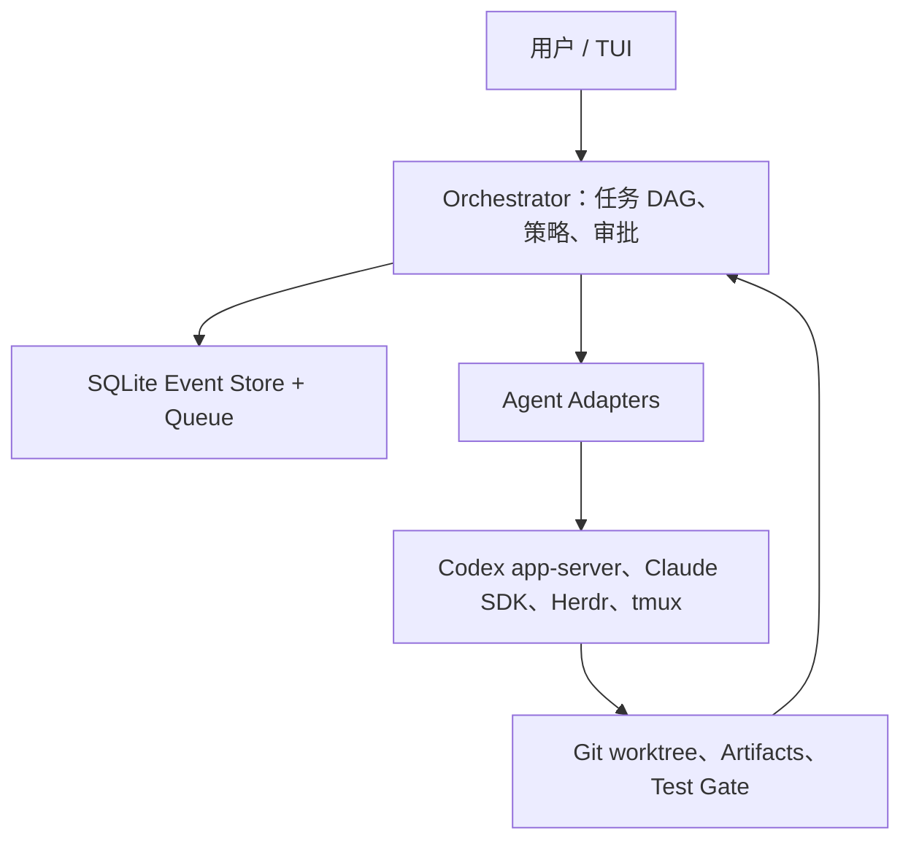

# TUI 里的多 Agent 协作：怎么选，怎么搭

这份笔记想解决一个具体问题：在终端里让多个 Agent 一起干活，到底该怎么搭。

这个话题容易空转，因为“多 Agent 协作”被用来指很多不同的东西。先把层次拆开，讨论才有意义。

## 五个层次别混着谈

**最外面是 TUI**，负责展示：有哪些任务、每个 Agent 在干什么、日志、待审批的东西、diff。

**往里是终端运行时**，比如 tmux 或 Herdr。它管 PTY、会话持久化、人随时接管某一个。这一层不关心任务语义。

**再往里是编排器**，负责拆任务、分配角色、处理依赖、重试、合并结果。这是真正的“调度”，也是大多数自制方案最薄弱的地方。

**通信层**决定消息怎么传：MCP、Unix socket、消息队列、app-server、A2A 都算，但位置差得很远。

**最底下是状态与隔离**：任务数据库、事件日志、Git worktree、artifact 存放。

有两组概念最容易被混淆：tmux 只解决运行时，不等于编排系统；MCP 解决的是 Agent 调用工具和数据，不是 Agent 和 Agent 之间的完整协议。很多方案看起来能跑，问题就出在这儿——用运行时冒充编排器，用屏幕文本冒充任务状态。

## 六种做法

### 1. tmux 开几个 pane，人当调度

最直接的起点。每个 pane 跑一个 CLI，人在中间传话。优点是几乎没有依赖，Claude、Codex、Gemini 都能用，detach、SSH、随时接管都是现成的。两到四个 Agent 并行做研究或互相审查，这个方式能撑住。

但它对任务状态完全无感知。tmux 不知道某个 Agent 是干完了、卡住了，还是正在等你按确认。你只能靠 `send-keys` 灌输入、`capture-pane` 抓屏幕，而屏幕上的文字是给人看的，不是给程序读的。再加上多个 Agent 共用一个 checkout，改同一个文件就会互相覆盖。Agent 一多，真正的瓶颈变成人的注意力。

适合：少量 Agent、人在场、周期短的研究和审查。

### 2. tmux + tmux-bridge-mcp：让 Agent 互相敲键盘

它把读 pane、写 pane、发消息、监控日志这些能力包装成 MCP 工具，Agent 于是能直接操作别的终端。不改现有 CLI 就能用，跨厂商也没问题，“调研 → 实现 → 审查”这条链能自动跑起来，非常适合快速验证。

代价在于它本质上还是对着终端灌文本。MCP 只是外壳结构化了，里面依然是模拟键击。终端焦点变化、权限弹窗、多行输入、TUI 重绘，都会带来竞态条件。更关键的是：“消息已输入”和“任务已接受”是两回事，“任务已接受”和“任务成功”又是两回事。而且一个 Agent 能间接控制别人的终端，权限边界开得相当大；大段 diff 和日志直接塞进 prompt，token 和误解一起涨。

如果要长期用，至少得补上任务 ID、ACK 回执、ready/blocked 状态、超时重试、文件引用，以及独立的 tmux socket。把它当兼容层，不要当唯一的事实来源。

### 3. 现成的团队方案：OMC、OMX、Claude Agent Teams

Claude 官方自己区分了两种模式。Subagent 是主 Agent 派出去、干完回报；Agent Team 则是多个独立会话，队友之间能直接通信，还共享一份任务列表。

OMC 走的是 `plan → PRD → execute → verify → fix` 这条固定流程。OMX 提供 PM、Executor、Tester、Reviewer、Autopilot、Team 等角色模式，也能混用不同厂商的 CLI。角色的划分、任务的拆分、验证和修复的回环都封装好了，你不用再手写一堆 prompt 和 shell 脚本，做常规开发和代码审查确实省事。

不过它跟具体供应商和版本绑得比较紧。每个队友都是独立的模型实例，人数一上去成本线性增长。更麻烦的是，任务状态、完成声明、上下文交接这些环节仍然可能不可靠；多个 Agent 同时改同一个文件，它也不会自动帮你解决。原生的团队机制通常也不支持完全自由的递归协作。

适合：流程相对标准的功能开发、审查、测试与修复。

### 4. 一个 Agent 带多个 Subagent

这是模型内部的 Supervisor/Subagent 模式，主 Agent 统一汇总结果。结构简单，子 Agent 上下文隔离，能有效控制主上下文的膨胀。并行调研、文档总结、代码审查、多假设排查这类任务很合适，并发数、模型、权限、token 预算都好限制。

但主 Agent 是中心瓶颈。子 Agent 之间一般不能直接沟通，中间过程被压成摘要，细节就在压缩中丢掉了。它天然不适合异构 CLI，也不适合需要人进终端干预的任务；共用一个目录时冲突照样存在。

适合：独立、只读、结果容易汇总的任务。

### 5. Supervisor 加 tmux Worker

混合思路：主 Agent 在自己的模型里调度，Worker 是外部 CLI 进程，各自跑在独立 tmux session 里。CAO 这类项目就是 Supervisor + Worker + MCP 编排工具的结构。

好处是能真正混用 Claude、Codex、Gemini、Kimi，各家的模型、工具、认证都保留原生状态，并行、串行、人工接管都能安排，做跨模型第二意见或竞争性实现很方便。

难点在一致性。调度器以为的状态、tmux 实际的状态、Agent 真正在做什么，这三者很容易对不上。进程崩溃、断网、权限阻塞、任务误报完成，都得单独处理。多层 prompt 还会让上下文一段段丢失；如果允许 Worker 再拉 Worker，很容易失控。自己实现的话，维护成本不低。

适合：异构 Agent、多步骤开发、必须保留原生 CLI 的场景。

### 6. Herdr：懂 Agent 的终端运行时

Herdr 保留了真实终端，日志、进程、SSH、detach 都在，同时能识别 Agent 状态，并对外提供 CLI 和 socket API，让 Agent 可以创建 pane、唤醒其他 Agent、等待其他 Agent。

相比 tmux 的盲操作，你更容易看出谁在干活、谁被卡住、谁已经空闲。Agent 数量上去以后，这个差别会很明显，人接管也更快。

它不提供任务 DAG、代码合并、质量门禁这些东西，状态检测也要靠集成、主动上报或屏幕识别，不同 Agent 的接入成熟度会有差异。所以它适合当 TUI 的运行时底座，而不是完整的协作方案。

适合：想保留终端工作流，但受够了 tmux 一无所知的人。

## 六种做法的速查

| 做法 | 主要优势 | 易出问题的地方 | 适合规模 |
| --- | --- | --- | --- |
| tmux + 人工 | 零依赖，原生能力完整 | 状态靠人看，文件易冲突 | 2～4 个 |
| tmux-bridge-mcp | 不改 CLI，跨厂商 | 文本交互脆弱，语义不可靠 | 少量到中等 |
| OMC / OMX / Teams | 流程封装好，上手快 | 供应商绑定，成本线性增长 | 中型流水线 |
| 单 Agent + Subagent | 结构简单，上下文隔离 | 中心瓶颈，细节丢失 | 只读任务 |
| Supervisor + tmux | 异构 CLI，保留原生能力 | 状态漂移，维护成本高 | 异构多步骤 |
| Herdr | 状态可观测，接管快 | 只管运行时 | 较多 Agent |

## 四条值得补的方向

**结构化接口优先。** 能用 API 就别敲键盘。Codex 的 app-server 走 JSON-RPC，支持线程创建、恢复、分叉，turn，取消，流式事件；Claude CLI 支持 JSON 和 `stream-json` 输出。状态准确，取消、恢复、重试都是原语，不用从屏幕文本里猜。代价是需要给每个厂商写 adapter，交互式 CLI 也无法全部覆盖。tmux 和 Herdr 这时退回到“显示与兜底”的位置。

**本地事件总线和任务队列。** 用 SQLite WAL 记状态、Unix socket 传消息、JSONL 存事件日志，把任务、Agent、消息、心跳、租约、审批、重试都放进去。状态机建议统一成一条线：

```text
queued → running → waiting_input / blocked → succeeded / failed / cancelled
```

有了这条线，“Agent 到底在干什么”才是个可查询的事实，而不是一次屏幕截图。

**Git worktree 加任务看板。** 并行写代码时，每个 Agent 各自一个 worktree 和 branch，reviewer 只读不改，测试过了再合。注意任务看板管状态、worktree 管文件隔离，两者是不同问题，不能指望其中一个顺手把另一个解决掉。

**A2A 与 MCP 的分工。** MCP 管 Agent 到工具、数据、资源；A2A 管 Agent 到 Agent，带能力发现、任务和 artifact 语义。本机少量 Agent 基本用不上 A2A，等出现跨机器、跨框架、跨组织的需求再引入。

## 推荐架构



各层分工：Herdr 做终端运行时和人工接管入口；Codex app-server 和 Claude SDK 做结构化调用；SQLite 加 Unix socket 组成本地控制平面；Git worktree 负责代码隔离；任务 DAG 管依赖、重试和合并；tmux-bridge 留给那些没有结构化 API 的 Agent，作为兼容层；A2A 等跨机器时再说。

TUI 上最该显示的五件事：任务 DAG 和依赖关系、每个 Agent 的状态和归属、等人处理的队列、当前 Agent 的终端或事件时间线、diff 与测试结果及审批请求。

## 落地路线

先做**手工版**，Herdr 或 tmux 加 worktree，角色定清楚，先跑通感觉。然后进**结构化版**，接 Codex app-server 和 Claude 的 stream-json/SDK，把“读屏幕”换成“读事件”。再做**编排版**，补 SQLite、事件日志、ACK、heartbeat、lease、retry 和审批，这时候系统才开始有可靠性可言。之后是**工程版**：任务 DAG、测试门、自动合并、失败后重新规划。最后才考虑**分布式版**，确实需要跨机器时引入 A2A。

每一层都能独立产生价值，不必等上一层的完美版本。

## 结论

Agent 少的时候，tmux 或 Herdr 就够了，别过度设计。只读的研究和审查交给 Subagent，最省事。要混多家 CLI，Herdr 配 Supervisor 加 worktree 是目前比较平衡的组合。要稳定自动化，就上 app-server/SDK 加事件总线。研发流水线复杂了，再补任务 DAG、reviewer 和测试门。跨机器协作是最后一步。

最不该长期用、但也最常见的模式：一堆 Agent 共用一个 checkout，靠自然语言和 pane 里的文本自由协商。它起步极快，然后状态漂移、文件冲突、失败无法恢复、权限边界说不清楚，这些问题会一起爆发，而那时候往往已经有一堆自动化依赖着它了。

## 相关阅读

- [多 Agent 模式总览](./index.md)：Supervisor、Swarm 与 Debate 三种拓扑的对比。
- [主控工程](../../design-surfaces/harness-engineering/index.md)：Harness 的组成、权限、状态与追踪。
- [MCP](../../protocols-and-interoperability/mcp.md)、[A2A](../../protocols-and-interoperability/a2a.md)：工具通信与 Agent 间通信的协议边界。
- [herdr 使用手册](../../../../terminal-tool-manuals/herdr.md)、[tmux 使用手册](../../../../terminal-tool-manuals/tmux.md)、[Oh My Codex 使用手册](../../../../terminal-tool-manuals/oh-my-codex.md)：本文涉及工具的具体配置。
