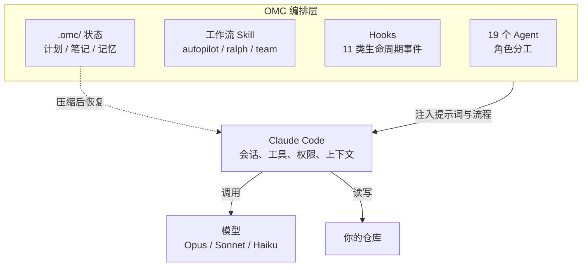
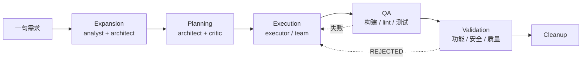
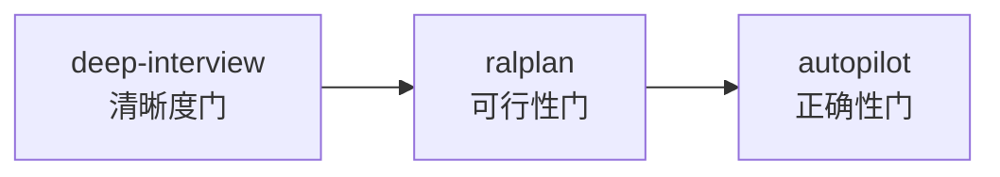
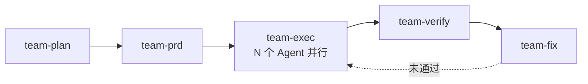
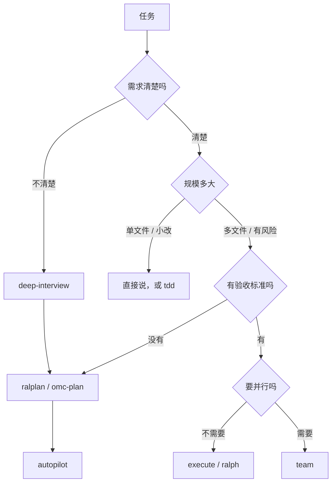

# Oh My ClaudeCode（OMC）使用手册（Windows / macOS / Linux）

> - **文档站**：<https://omc.vibetip.help/>（侧栏版本 **v4.15.0**）
> - **上游仓库**：<https://github.com/Yeachan-Heo/oh-my-claudecode>（MIT）
> - **npm 包**：`oh-my-claude-sisyphus`（截至 2026-10-29 最新 **v5.7.19**，2026-10-27 发布）
> - **前置**：Claude Code CLI；Claude Max/Pro 订阅或 `ANTHROPIC_API_KEY`；Node.js；`tmux`（多 Agent 的 CLI 并行需要）
> - **整理日期**：2026-10-29
> - **版本提示**：文档站侧栏停在 v4.15.0，而上游已经到 v5.7.x。本文按文档站的结构讲概念，**命令与配置按上游当前版本核对**；凡是两边不一致或只在新版存在的能力，都会明确标注。真机以 `omc --version` 和 `/oh-my-claudecode:omc-doctor` 的输出为准。

**适合谁读：**

- 已经用过 Claude Code，但一遇到多文件、长任务就翻车的人；
- 想用多 Agent，又不想自己写编排脚本的人；
- 需要给团队落地一套「有流程、能验收」的 AI 开发方式的人。

**不适合谁：** 还没装过 Claude Code、也不熟悉终端和 git 的读者。先把 Claude Code 的基本会话、权限和 `CLAUDE.md` 用熟，再回来——OMC 是放大器，不是替代品。

---

## 目录

0. [先给结论](#0-先给结论)
1. [OMC 是什么](#1-omc-是什么)
2. [安装前的准备](#2-安装前的准备)
3. [安装](#3-安装)
4. [初始化：omc-setup](#4-初始化omc-setup)
5. [第一次会话](#5-第一次会话)
6. [核心概念：Agent、Skill、Hook、State](#6-核心概念agentskillhookstate)
7. [工作流详解](#7-工作流详解)
8. [实战配方](#8-实战配方)
9. [配置](#9-配置)
10. [成本与上下文管理](#10-成本与上下文管理)
11. [中文用户的专属问题](#11-中文用户的专属问题)
12. [故障排查](#12-故障排查)
13. [卸载与回滚](#13-卸载与回滚)
14. [速查表](#14-速查表)
15. [名词表](#15-名词表)
16. [参考资料](#16-参考资料)

---

## 0. 先给结论

如果你已经装好 Claude Code，并且能正常登录，最短路径只有四步：

```bash
# 1. 在 Claude Code 会话里，一次一条地执行
/plugin marketplace add https://github.com/Yeachan-Heo/oh-my-claudecode
/plugin install oh-my-claudecode

# 2. 初始化（第一次强烈建议先只作用于当前项目）
/oh-my-claudecode:omc-setup --local

# 3. 体检
/oh-my-claudecode:omc-doctor

# 4. 干一件真事
autopilot 帮我做一个记录每日习惯的命令行工具，数据存本地 JSON
```

> 第 1 步的两条 `/plugin` 命令**必须逐条执行**。官方 README 明确写了：一次粘贴两行会失败。

如果你更想用终端命令，或者要在 CI 里用：

```bash
npm i -g oh-my-claude-sisyphus@latest
omc setup
omc --version
```

先记住一句话：**OMC 不换模型、不换 Claude Code，它给 Claude Code 装了一套「角色分工 + 标准流程 + 记忆 + 监控」。** 它的价值在长任务、多文件、需要反复验证的工程场景；改一个错别字用它属于高射炮打蚊子。

---

## 1. OMC 是什么

### 1.1 它解决的问题

裸 Claude Code 像一个能力很强、但没有岗位分工的实习生：你说一句它做一步。任务一旦变成「多文件改造 + 要跑测试 + 要过审查 + 中途上下文还会被压缩」，就会出现四类典型失控：

| 失控表现 | 具体长什么样 | OMC 的应对 |
|---|---|---|
| 没有角色 | 让同一个会话既做架构又写代码又自审 | 19 个专用 Agent，按职责分工 |
| 没有流程 | 上来就改代码，改到一半发现方向错了 | autopilot / ralplan 先分析、设计、评审 |
| 没有记忆 | 上下文一压缩，前面谈好的约束全丢 | `.omc/` 状态目录 + notepad + project memory |
| 没有验收 | 模型说「完成了」，其实测试根本没跑 | verifier / verify / autopilot 的 QA 阶段，要求证据 |

所以 OMC 的定位是**编排层（orchestration layer）**，不是新的 AI 引擎。

### 1.2 与 Claude Code、oh-my-codex 的关系



- **Claude Code**：真正的执行引擎，负责工具调用、权限、上下文窗口。
- **OMC**：在会话之上加角色、流程、状态和监控。
- **模型**：仍然是 Anthropic 的 Opus / Sonnet / Haiku（或你通过中转、Bedrock、Vertex 接入的等价模型）。

同作者的 [oh-my-codex](https://github.com/Yeachan-Heo/oh-my-codex) 是同一套思路套在 OpenAI Codex CLI 上。两者概念高度相似（Agent、Skill、Team、HUD、`.omx/` vs `.omc/`），但**命令和配置不通用**，别混着抄。

### 1.3 四个构建块

| 构建块 | 一句话解释 | 谁在用 |
|---|---|---|
| **Agent** | 带角色提示词和默认模型的「岗位」 | OMC 自动委派，或你显式点名 |
| **Skill** | 一段可复用的工作流指令，用 `/oh-my-claudecode:xxx` 或魔法关键词触发 | 你直接用 |
| **Hook** | 挂在 Claude Code 生命周期事件上的脚本，负责识别关键词、防中断、压缩前存档 | 后台自动跑 |
| **State** | `.omc/` 下的计划、笔记、记忆、日志 | 跨轮次、跨压缩、跨会话 |

对新手来说，只需要先记住两件事：

1. **想干活** → 用 Skill（`/autopilot`、`/team`、`ralplan`…）。
2. **想让它记住** → 用 `/remember`，或者把约束写进 `CLAUDE.md`。

---

## 2. 安装前的准备

### 2.1 清单

| 项目 | 要求 | 怎么检查 |
|---|---|---|
| Claude Code | 已安装且能正常对话 | `claude --version`，会话里发一句话 |
| 认证 | Max/Pro 订阅，或 `ANTHROPIC_API_KEY` | 会话能正常回复即可 |
| Node.js | 建议 20 及以上（npm 路线必需） | `node -v` |
| git | 强烈建议在 git 仓库里用 | `git status` |
| tmux | `omc team`、限流自动恢复需要 | `tmux -V` |
| 终端 | 支持真彩色、宽一点的窗口 | HUD 才显示得下 |

### 2.2 平台差异

| 平台 | 推荐路径 | 备注 |
|---|---|---|
| macOS | 插件 + 原生 tmux | 官方主路径 |
| Linux | 插件 + 原生 tmux | 官方主路径 |
| Windows（WSL2） | 在 WSL 里装 Claude Code + tmux + OMC | **最稳的 Windows 方案** |
| Windows（原生） | 插件 + `psmux` | 官方标注为实验性，tmux 相关能力可能受限 |

Windows 原生装 tmux 替代品：

```powershell
winget install psmux
```

WSL2 里则是常规的：

```bash
sudo apt update && sudo apt install -y tmux
```

### 2.3 国内网络与中转 API

这一节文档站没写，但对国内用户很关键。

**（1）GitHub 访问。** 插件市场是直接从 GitHub 拉仓库的，`/plugin marketplace add` 失败基本都出在网络。处理顺序：

1. 终端里能 `git clone` 该仓库；
2. Claude Code 进程继承同样的代理环境变量（`HTTPS_PROXY` / `ALL_PROXY`）；
3. 实在不行走 npm 路线，npm 可以配镜像。

**（2）npm 镜像。** 包名是 `oh-my-claude-sisyphus`，不是 `oh-my-claudecode`：

```bash
npm config get registry
npm i -g oh-my-claude-sisyphus@latest
```

**（3）中转 / CC Switch / Bedrock / Vertex。** 这是最容易踩的坑：OMC 默认会做模型分层路由，把 `haiku` / `sonnet` / `opus` 这些名字传给上游。中转站如果不认识这些名字，就会报模型不存在。

官方配置文档写得很清楚：使用 CC Switch、自定义 `ANTHROPIC_BASE_URL`、AWS Bedrock 或 Google Vertex AI 时，`routing.forceInherit` 会**自动置为 true**，让所有 Agent 继承父会话模型。你需要做的是：

- 不要手动把它改回 `false`；
- 如果中转的模型名很特殊，用 `OMC_MODEL_ALIAS_HAIKU` / `OMC_MODEL_ALIAS_SONNET` / `OMC_MODEL_ALIAS_OPUS` 做映射；
- 出问题时先跑 `omc doctor`，再看会话里有没有模型 404。

---

## 3. 安装

OMC 有两个可以共存的门面（surface），官方推荐「两个都装」：

| 门面 | 你得到什么 | 安装方式 |
|---|---|---|
| Claude Code 插件 | 会话内的 skill、agent、hook、状态栏、斜杠命令 | 插件市场 |
| 终端 CLI（`omc`） | `omc setup`、`omc update`、`omc team`、`omc ask` 等 | `npm i -g oh-my-claude-sisyphus@latest` |

只装 CLI 不会有 `/autopilot` 这类会话内技能；只装插件则用不了 `omc team` 的 tmux 工作进程。两者都装时，CLI 会检测到插件，避免重复注册技能。

### 3.1 插件路线（大多数人选这个）

在 Claude Code 会话里**逐条**执行：

```bash
/plugin marketplace add https://github.com/Yeachan-Heo/oh-my-claudecode
```

成功后再执行：

```bash
/plugin install oh-my-claudecode
```

### 3.2 终端 CLI 路线

```bash
npm i -g oh-my-claude-sisyphus@latest
omc setup
```

安装时可能看到 `deprecated prebuild-install@7.1.3` 警告。官方 README 说明它来自上游 `better-sqlite3` 的依赖链，**不代表安装失败**，可以忽略。

### 3.3 纯 npm、不装插件

适合「不想动插件市场、只想一条命令搞定」的人：

```bash
npm i -g oh-my-claude-sisyphus@latest && omc setup --no-plugin
```

`--no-plugin` 会把自带的 agent、skill、hook 直接写进 `~/.claude`，并注册 `omc` 命令。

### 3.4 验证安装

会话内：

```bash
/oh-my-claudecode:omc-doctor
```

终端：

```bash
omc --version
omc doctor
```

`omc-doctor` 会检查：依赖是否缺失、配置是否合法、hook 是否装上、agent 是否可用、skill 是否注册。

### 3.5 更新

| 安装方式 | 更新命令 |
|---|---|
| 插件 | `/plugin marketplace update omc`，然后重跑 `/oh-my-claudecode:omc-setup` |
| npm | `npm i -g oh-my-claude-sisyphus@latest` |
| 本地 checkout | 先 `git pull`，再从该目录重跑 setup |

官方还会每 24 小时静默检查一次更新，但**更新后必须重跑 setup**，否则 `CLAUDE.md` 里的指令可能还是旧版。

---

## 4. 初始化：omc-setup

### 4.1 local 还是 global

这是整个安装过程中最容易造成损失的一步。

| 作用域 | 命令 | 写入位置 | 适用场景 |
|---|---|---|---|
| 项目级 | `/oh-my-claudecode:omc-setup --local` | `./.claude/CLAUDE.md` | **推荐**：单个项目、想保留自己的全局配置 |
| 全局 | `/oh-my-claudecode:omc-setup` | `~/.claude/CLAUDE.md` | 所有项目统一行为 |

也可以直接说人话：

```txt
setup omc
```

不带参数会进交互式向导，让你选作用域。

### 4.2 它到底改了什么

主要是两类文件：

1. **`CLAUDE.md`**：写入 OMC 的行为约定（自动委派、关键词、完成度要求等）。项目级优先于全局。
2. **配置与组件**：`~/.config/claude-omc/config.jsonc`、hook 脚本、skill 注册、状态栏等。

### 4.3 如何避免覆盖自己的 CLAUDE.md

官方 getting-started 写得很直白：**全局 setup 会覆盖已有的 `~/.claude/CLAUDE.md`**。Linux.do 上的用户反馈也印证了这一点（「omc-setup 会覆盖你自己的……」）。三种应对方式，按推荐度排序：

**做法一（推荐）：用 `--local`。** 每个项目单独初始化，全局文件不动。

**做法二：保留模式。** 全局 setup 时选择保留，OMC 会把内容写到 `~/.claude/CLAUDE-omc.md`，`omc` 启动时强制加载这个伴随文件，而直接跑 `claude` 不受影响。

**做法三：彻底退出全局管理。** 在 `~/.claude/.omc-config.json` 写：

```json
{ "claudeMdEnabled": false }
```

之后 `omc install` / `omc update` / 全局 setup 都不会再动 `~/.claude/CLAUDE.md` 和 `CLAUDE-omc.md`，`omc doctor` 只把它当提示信息。项目级 `--local` 不受影响。

> 不管用哪种，**第一次跑之前先备份**：
>
> ```bash
> cp ~/.claude/CLAUDE.md ~/.claude/CLAUDE.md.bak
> ```

### 4.4 什么时候要重跑

- 首次安装后；
- 每次更新插件或 npm 包后；
- 换新机器；
- 新项目需要项目级配置时（用 `--local`）。

---

## 5. 第一次会话

### 5.1 跑一个最小任务

先别上真实项目。找一个空目录：

```bash
mkdir -p ~/tmp/omc-hello && cd ~/tmp/omc-hello && git init
claude
```

在会话里输入：

```txt
autopilot 帮我做一个 hello world 命令行程序，要求有测试、有 README
```

你会看到它依次做这些事（HUD 会显示当前阶段）：

1. **Expansion**：analyst 澄清需求，architect 写技术规格 → `.omc/autopilot/spec.md`
2. **Planning**：architect 出计划，critic 挑毛病 → `.omc/plans/autopilot-impl.md`
3. **Execution**：executor 写代码；需要并行时开多个 executor，ralph 保证不半途而废
4. **QA**：跑构建、跑测试，失败自动修，最多 5 轮
5. **Validation**：功能、安全、代码质量三方审查，全过才算完
6. **Cleanup**：清理状态文件

> 文档站的「Guides」页写成 5 阶段（把 Cleanup 不算），技能详情页写成 6 阶段。两种说法指的是同一套流程，不用纠结。

### 5.2 HUD 怎么读

运行中状态栏大概长这样：

```txt
[OMC] autopilot:execution | agents:3 | todos:2/5 | ctx:45%
```

| 字段 | 含义 | 你该做什么 |
|---|---|---|
| `autopilot:execution` | 当前阶段 | 卡在同一阶段很久 → 看日志 |
| `agents:3` | 活跃 Agent 数 | 突然归零但任务没完成 → 可能异常退出 |
| `todos:2/5` | 任务进度 | 数字不动 → 多半在死循环 |
| `ctx:45%` | 上下文占用 | 超过 80% 要准备压缩或收尾 |

改 HUD 样式：

```bash
/oh-my-claudecode:hud setup
```

### 5.3 第一次就该建立的三个习惯

1. **在 git 仓库里用。** 出问题能 `git diff`、能回滚。新版还可以用 `omc checkpoint` 打快照（见 8.8）。
2. **先看计划再放行。** autopilot 支持 `pauseAfterExpansion` / `pauseAfterPlanning`，复杂项目建议打开，确认规格再让它写代码。
3. **「完成」必须有证据。** 让模型贴出构建/测试命令的实际输出，而不是一句「已完成」。

---

## 6. 核心概念：Agent、Skill、Hook、State

### 6.1 Agent：19 个岗位

Agent 用 `oh-my-claudecode:agent-name` 的形式调用，但大多数时候你不需要点名——orchestrator 会按任务类型委派。

| 分组 | Agent | 默认模型 | 职责 |
|---|---|---|---|
| 构建与分析 | `explore` | haiku | 找文件、找模式、摸清代码结构 |
| | `analyst` | opus | 需求分析，挖隐藏约束 |
| | `planner` | opus | 任务拆解与执行顺序 |
| | `architect` | opus | 系统设计、接口定义、权衡 |
| | `debugger` | sonnet | 定位根因、修构建错误 |
| | `executor` | sonnet | 写代码、重构 |
| | `verifier` | sonnet | 验证完成度、测试是否充分 |
| | `tracer` | sonnet | 基于证据的因果追踪，多假设并行 |
| 审查 | `security-reviewer` | opus | 漏洞、信任边界、认证授权 |
| | `code-reviewer` | opus | 综合代码审查、API 契约、向后兼容 |
| 领域 | `test-engineer` | sonnet | 测试策略、覆盖率、flaky 治理 |
| | `designer` | sonnet | UI/UX 架构与交互 |
| | `writer` | haiku | 文档、迁移说明 |
| | `qa-tester` | sonnet | 通过 tmux 跑真实 CLI/服务做运行验证 |
| | `scientist` | sonnet | 数据分析、统计 |
| | `git-master` | sonnet | 提交、rebase、历史整理 |
| | `document-specialist` | sonnet | 查外部文档、API、SDK |
| | `code-simplifier` | opus | 简化代码、提升可读性 |
| 协调 | `critic` | opus | 从多角度挑计划的漏洞 |

**选型速查：**

| 你想干的事 | 用谁 | 备注 |
|---|---|---|
| 快速找代码 | `explore` | 别用 opus，浪费 |
| 实现一个功能 | `executor` | 复杂重构可临时提到 opus |
| 修简单 bug | `debugger` | 复杂问题交给 `architect` |
| 做 UI | `designer` | |
| 写测试策略 | `test-engineer` | |
| 安全审计 | `security-reviewer` | 支付、认证相关必做 |
| 提交前审查 | `code-reviewer` | |
| 查第三方文档 | `document-specialist` | 配合 context7 更好 |

**角色边界**很重要：`planner` 不做需求分析，`critic` 不写代码，`architect` 不做计划评审。OMC 用这些边界防止「自说自话自验收」。

### 6.2 Skill：比 Agent 更高一层的「流程」

Agent 是「谁来做」，Skill 是「按什么流程做」。Skill 可以组合，例如 `tdd + git-master`。

两种触发方式：

| 方式 | 例子 | 特点 |
|---|---|---|
| 斜杠命令 | `/oh-my-claudecode:autopilot "做一个待办应用"` | 明确、可带参数、推荐 |
| 魔法关键词 | `autopilot 做一个待办应用` | 自然语言，但只认英文关键词 |

> 关键词只在**普通文本**里匹配。`keyword-detector` 会先剥掉代码块、URL、文件路径，避免误触发。所以把 `autopilot` 写在代码围栏里不会生效。

**工作流技能（会跑流水线）：**

| Skill | 作用 | 关键词 / 调用 |
|---|---|---|
| `autopilot` | 从一句想法到能跑的代码，全自动 | `autopilot`、`build me`、`I want a` |
| `ralph` | 不验证通过不停止的循环 | `ralph`、`don't stop`、`must complete` |
| `team` | N 个 Agent 协同，5 阶段流水线 | 必须用 `/team`，不自动触发 |
| `execute` | 把已批准的任务做到验证通过 | `/execute` |
| `verify` | 声明完成前的证据检查 | `/verify` |
| `tdd` | 测试先行 | `tdd`、`test first`、`red green` |
| `ralplan` | Planner/Architect/Critic 达成共识的规划 | `ralplan` |
| `plan`（`omc-plan`） | 访谈式战略规划 | `/omc-plan` |
| `deep-interview` | 苏格拉底式追问，把模糊想法问清楚 | `deep interview`、`ouroboros` |
| `ultragoal` | 可持久化的多目标账本 | `/ultragoal` |
| `external-context` | 并行查外部文档 | `/external-context` |
| `deepinit` | 生成分层 `AGENTS.md` | `/deepinit` |
| `self-improve` | 自主进化式代码改进 | `/self-improve` |
| `ask` | 调 Claude/Codex/Gemini 等外部 CLI 会诊并留存产物 | `/ask codex "..."` |
| `research` | 带来源的调研 | `/research` |

**v4.15 文档里还有、但 v5 已合并或下线的技能**（照旧文档敲会找不到）：

| 旧技能 | 现状 | 现在用什么 |
|---|---|---|
| `ultrawork` / `ulw` | 不再作为独立技能 | `/team` 并行，或直接交给 executor |
| `ultraqa` | 并入 autopilot 的 QA 阶段 | `/verify` 或 autopilot |
| `ccg` | 独立技能下线 | `/ask codex` + `/ask gemini`，由 Claude 汇总 |
| `sciomc` | 下线 | `scientist` agent 或 `/research` |
| `deep-dive` | 下线 | `/trace` + `/deep-interview` |
| `omc-teams` | 统一走 CLI | `omc team` |
| `note` | 被 `remember` 取代 | `/remember` |

**常用工具技能：**

| Skill | 作用 |
|---|---|
| `cancel` | 取消所有激活模式 |
| `remember` | 把会话里的知识分拣到项目记忆、便签或文档（旧版文档里叫 `note`） |
| `hud` | 配置状态栏 |
| `omc-setup` / `omc-doctor` | 初始化 / 诊断 |
| `skillify` | 从当前会话提取可复用技能 |
| `skill` | 列出、添加、删除、搜索本地技能 |
| `trace` | 多假设因果追踪 |
| `release` | 发布流程 |
| `debug` | 诊断会话、hook、状态 |
| `verify` | 声明完成前的证据检查 |
| `wiki` | 持久化 Markdown 知识库 |
| `ask` | 调用 Claude/Codex/Gemini 等外部 CLI 并留存产物 |
| `configure-notifications` | Telegram / Discord / Slack 通知 |
| `project-session-manager` | git worktree + tmux 隔离开发环境 |
| `visual-verdict` | 截图与设计稿的结构化视觉比对 |

> 数量口径：文档站说 38 个，上游 v5 的 `REFERENCE.md` 列了 48 个（含兼容别名和内部技能）。**别背清单**，用 `/oh-my-claudecode:skill list` 看当前装了什么。

### 6.3 Hook：让它「自己动起来」

Claude Code 有 11 类生命周期事件，OMC 在这些事件上挂了脚本：

| 事件 | 触发时机 | OMC 用来做什么 |
|---|---|---|
| `UserPromptSubmit` | 你提交提示词 | 识别魔法关键词、注入技能指令 |
| `SessionStart` | 会话开始 | 初始化、加载项目记忆 |
| `PreToolUse` | 工具调用前 | 权限校验、并行提示 |
| `PermissionRequest` | 请求权限 | Bash 命令权限处理 |
| `PostToolUse` | 工具调用后 | 校验结果、更新项目记忆 |
| `PostToolUseFailure` | 工具失败后 | 错误恢复 |
| `SubagentStart` / `SubagentStop` | 子 Agent 启停 | 跟踪 Agent、校验输出 |
| `PreCompact` | 上下文压缩前 | 把重要信息写进 notepad |
| `Stop` | 模型准备停下 | 维持 ralph 等持久模式、代码简化 |
| `SessionEnd` | 会话结束 | 清理会话数据 |

几个关键 hook：

- **keyword-detector**：识别关键词。带安全护栏——代码块、URL、文件路径里的词不算；`OMC_TEAM_WORKER` 存在时禁用，防止无限套娃。
- **persistent-mode**：在 ralph 等持久模式激活时阻止模型提前收工。看到 `The boulder never stops` 说明它正在工作。
- **pre-compact**：压缩前存档。
- **context-guard-stop**：上下文快满时告警。
- **code-simplifier**：默认关闭。开启后，模型停下的瞬间会自动简化改动过的文件。

临时关掉：

```bash
# 全关
export DISABLE_OMC=1

# 只关某几个
export OMC_SKIP_HOOKS="keyword-detector,persistent-mode"
```

> 排查「是不是 OMC 的锅」时，先 `DISABLE_OMC=1` 再复现。能复现就不是 OMC；不能复现，再用 `OMC_SKIP_HOOKS` 二分。

### 6.4 State：上下文被压缩后靠什么活下来

所有运行时状态默认在项目里的 `.omc/`：

```txt
.omc/
├── state/                     # 各模式的进度
│   ├── autopilot-state.json
│   ├── ralph-state.json
│   ├── team/
│   └── sessions/{sessionId}/
├── notepad.md                 # 抗压缩便签
├── project-memory.json        # 项目级长期记忆
├── plans/                     # 执行计划
├── autopilot/spec.md          # 规格
├── notepads/{plan-name}/      # 每个计划的经验沉淀
│   ├── learnings.md
│   ├── decisions.md
│   ├── issues.md
│   └── problems.md
├── research/
└── logs/
```

四层记忆，各有用途：

| 机制 | 存什么 | 活多久 | 怎么用 |
|---|---|---|---|
| notepad | 当前任务的关键结论、约束 | 跨压缩，会话内 | `/oh-my-claudecode:remember "..."` |
| project memory | 项目结构、约定、踩过的坑 | 跨会话 | 自动 + `remember` 技能 |
| plan notepad | 每个计划的决策与问题 | 跟着计划走 | 自动 |
| `<remember>` 标签 | 显式要求记住的事 | 7 天 / 永久 | 见下 |

`<remember>` 的用法：

```txt
<remember>API 端点已经换成 /v2</remember>
<remember priority>永远不要直连生产数据库</remember>
```

| 标签 | 保留时间 |
|---|---|
| `<remember>` | 7 天 |
| `<remember priority>` | 永久 |

**关于 git：**

- `.omc/` 里是运行时状态，**默认不要提交**（可能包含提示词、转录、机器路径）；
- 唯一例外是 `.omc/skills/**`——项目级技能建议提交，团队共享；
- 如果用 git worktree 并行开发，worktree 删除会带走它自己的 `.omc/`。要保状态就设 `OMC_STATE_DIR`：

```bash
export OMC_STATE_DIR="$HOME/.claude/omc"
```

设置后状态落在 `$OMC_STATE_DIR/{project-id}/`，项目标识来自 git remote 哈希，同一个仓库的不同 worktree 共享状态。

- 多个独立仓库放在同一个父目录时，在父目录放一个 `.omc-workspace` 标记，让它们共享父级状态根。

---

## 7. 工作流详解

### 7.1 autopilot：一句话到能跑的代码

```bash
/oh-my-claudecode:autopilot "用 TypeScript 写一个书店库存 REST API，带 CRUD"
```

或者：

```txt
autopilot 帮我做一个记账 CLI，支持分类统计
build me a CLI tool that tracks daily habits
```



**产物：**

| 文件 | 内容 |
|---|---|
| `.omc/autopilot/spec.md` | 需求规格 |
| `.omc/plans/autopilot-impl.md` | 实施计划 |
| `.omc/state/autopilot-state.json` | 当前进度 |

**跳阶段：** 如果已经有 `ralplan` 的共识计划，Phase 0/1 会跳过；如果已经有 `deep-interview` 的 spec，会直接把它当 Expansion 产物。这是三个技能能串起来的原因。

**可调参数**（当前版本写在 `.claude/omc.jsonc` 或用户级 `~/.config/claude-omc/config.jsonc`；v4.15 文档给的位置是 `.claude/settings.json` 的 `omc.autopilot`，以你装的版本为准）：

```json
{
  "autopilot": {
    "maxIterations": 10,
    "maxQaCycles": 5,
    "maxValidationRounds": 3,
    "pauseAfterExpansion": false,
    "pauseAfterPlanning": false,
    "skipQa": false,
    "skipValidation": false,
    "execution": "solo"
  }
}
```

| 参数 | 默认 | 建议 |
|---|---|---|
| `maxIterations` | 10 | 大项目可加到 20，但先确认规格没跑偏 |
| `maxQaCycles` | 5 | 同一错误重复 3 次会被判定为根因问题并停止 |
| `maxValidationRounds` | 3 | 安全敏感项目别关 |
| `pauseAfterExpansion` | false | **复杂项目建议 true**，先审规格 |
| `pauseAfterPlanning` | false | 计划出来先停一下，确认方向 |
| `skipQa` / `skipValidation` | false | 只建议一次性脚本或 demo 打开 |
| `execution` | `solo` | 改成 `team` 会用 tmux CLI worker 执行 |

**取消与恢复：**

```txt
cancelomc
```

或：

```bash
/oh-my-claudecode:cancel
```

取消会保留进度，用同样的命令重跑即可续上。

**什么时候别用 autopilot：**

- 改一个错别字、加一行日志；
- 需求本身没想清楚（先用 `deep-interview`）；
- 生产环境的高风险变更（先 `ralplan --deliberate`，再人工审计划）；
- 你只想让它解释一段代码。

### 7.2 ralph：不达目的不罢休

ralph 是 autopilot 内部的执行引擎，也可以单独用：

```bash
/oh-my-claudecode:ralph "把 auth 模块重构成基于 JWT 的实现"
```

关键词：`ralph`、`don't stop`、`must complete`、`until done`。

它的核心是 **PRD 驱动的循环**：

1. 首轮生成 `prd.json`，把需求拆成带验收标准的故事；
2. 挑优先级最高的未完成故事实现；
3. 逐条验收，全部满足才标 `passes: true`；
4. 全部完成后进入 reviewer 验证；
5. 验证通过才清理状态。

```json
{
  "stories": [
    {
      "id": "US-001",
      "title": "增加 flag 解析工具函数",
      "acceptanceCriteria": [
        "detectNoPrdFlag('ralph --no-prd fix') 返回 true",
        "npm run build 无类型错误"
      ],
      "passes": false
    }
  ]
}
```

常用参数：

| 参数 | 作用 | 场景 |
|---|---|---|
| `--no-prd` | 跳过 PRD 生成 | 改文档、改错别字这类小任务 |
| `--critic=architect` | 用 architect 做完成审查（默认） | 通用 |
| `--critic=critic` | 用 critic | 更挑剔 |
| `--critic=codex` | 用 Codex CLI 审查 | 你需要装并登录 Codex CLI |

> ralph 的「不停」是双刃剑。它适合「验收标准明确」的任务；如果验收标准本身模糊，它会一直修一个你其实不在乎的问题。**先写清楚什么叫完成。**

### 7.3 规划：deep-interview → ralplan → autopilot

OMC 最值钱的用法不是「自动写代码」，而是**在写代码前把问题问清楚**。



| 阶段 | 解决的问题 | 产物 |
|---|---|---|
| `deep-interview` | 你到底想要什么 | `.omc/specs/deep-interview-{slug}.md` |
| `ralplan` | 这个方案靠不靠谱 | 共识计划 |
| `autopilot` | 代码能不能跑 | 可运行代码 + 验证证据 |

**deep-interview** 会按权重给「模糊度」打分：

| 维度 | 新项目权重 | 改存量项目权重 |
|---|---|---|
| 目标清晰度 | 40% | 35% |
| 约束清晰度 | 30% | 25% |
| 成功标准清晰度 | 30% | 25% |
| 现有系统理解 | — | 15% |

默认阈值是 **20%**，超过就继续问。第 4、6、8 轮会切换提问视角（反方、极简主义者、本体论者），避免一路顺着你说。

```bash
/oh-my-claudecode:deep-interview "我想做一个任务管理应用"
```

**ralplan** 是三方共识：

```txt
Planner 出计划
  → Architect 技术评审
    → Critic 挑漏洞
      → 有分歧？回到 Planner
        → 无分歧 → 定稿
```

```bash
/oh-my-claudecode:ralplan "设计支付系统"
/oh-my-claudecode:ralplan --deliberate "生产数据库迁移"
```

`--deliberate` 会加预演失败分析（pre-mortem）、要求单元/集成/E2E/可观测性测试计划，并延长讨论轮次。**高风险变更值得多花这点 token。**

**普通规划**：

```bash
/oh-my-claudecode:omc-plan "重构认证系统"
/oh-my-claudecode:omc-plan --consensus "重构认证系统"
/oh-my-claudecode:omc-plan --review "分析当前计划的问题"
```

**plan 文件是只读的。** 不要在执行阶段让 Agent 随手改计划，否则「验收标准」会被改到刚好通过。

### 7.4 team：多 Agent 并行

team 是 v4.1.7 之后的主推方式，5 阶段流水线：



**先开原生团队开关**（`~/.claude/settings.json`）：

```json
{
  "env": {
    "CLAUDE_CODE_EXPERIMENTAL_AGENT_TEAMS": "1"
  }
}
```

不开启时 OMC 会警告，并在可能的情况下退回非团队执行。

**用法：**

```bash
# 3 个 executor 一起修 TypeScript 错误
/team 3:executor "修复项目里所有 TypeScript 错误"

# 5 个 debugger 修构建
/team 5:debugger "修复 src/ 下的构建错误"

# 自动决定人数与角色
/team "重构 auth 模块，并做安全审查"

# team + ralph：失败重试，验证通过才停
/team ralph "实现完整的用户管理 REST API"

# 用 Codex CLI 工作进程做安全审查
/team 3:codex "审查所有 API 端点的安全问题"
```

格式是 `N:agent-type "任务"`，N 建议 2–5（上限 20）。

**CLI 的 team 是另一套运行时：**

```bash
omc team 2:codex "审查 auth 模块的安全问题"
omc team 2:gemini "重新设计 UI 组件，提升可访问性"
omc team status auth-review
omc team shutdown auth-review --force
```

它会在 tmux 里开真实的工作进程（`claude` / `codex` / `gemini` / `antigravity` / `grok` / `cursor-agent`），任务完成即退出。

> Gemini CLI 正在被 Google 的 Antigravity CLI（`agy`）取代。新项目优先用 `antigravity`，已有 Gemini 订阅或 API key 的继续用 `gemini` 也不影响。

要求：

1. 装了 tmux（Windows 原生用 psmux）；
2. 对应的 CLI 已安装并登录；
3. 有活跃的 tmux 会话（或允许它自己起一个 detached 会话）。

**成本警告：** team 会同时烧多份 token。简单任务用单 Agent 更划算。官方也建议在 team 之前先跑 `ralplan`，避免 N 个 Agent 一起跑错方向。

**team 与 autopilot 怎么选：**

| 维度 | autopilot | team |
|---|---|---|
| 自动化程度 | 全自动 5–6 阶段 | 半自动，需要你给方向 |
| Agent 数量 | 自动决定 | 你指定 |
| 适合 | 端到端交付一个小系统 | 某一阶段需要并行加速 |
| 成本 | 高 | 更高 |

### 7.5 并行与 QA：v4.15 的 ultrawork / ultraqa 去哪了

v4.15 文档把 `ultrawork`（最大并行）和 `ultraqa`（测试—验证—修复循环）当作独立技能。v5 里这两个入口已经收编：

- **并行** → `/team`，或者把互不依赖的子任务分别交给 executor；
- **QA 循环** → autopilot 的 Phase 3，或者单独跑 `/verify`。

```txt
/team 3:executor "给 src/utils 下所有模块补单元测试"
/verify "构建、lint、测试全部通过"
```

如果你在旧教程里看到 `ultrawork ...` / `ultraqa ...`，在 v5 上不一定还能触发。**新写的提示词不要依赖这两个词。**

### 7.6 execute / verify / tdd / trace / debug

v5 之后这几个技能值得单独记：

| 命令 | 用途 | 典型场景 |
|---|---|---|
| `/oh-my-claudecode:execute <task>` | 把一个已批准的任务做到「验证通过」 | 你已经有计划，只差执行 |
| `/oh-my-claudecode:verify <target>` | 声明完成前，用证据检查 | 提交前、发版前 |
| `/oh-my-claudecode:tdd` | 测试先行 | 新增功能、修 bug 都适用 |
| `/oh-my-claudecode:trace` | 多假设并行、证据驱动的追踪 | 复杂 bug、性能回退 |
| `/oh-my-claudecode:debug` | 诊断 OMC 自身状态 | hook/状态/编排异常 |

**trace 的工作方式**值得单独说：

```txt
观察问题
  ├─ 假设 A → tracer A 收集证据
  ├─ 假设 B → tracer B 收集证据
  └─ 假设 C → tracer C 收集证据
        ↓
  汇总正反证据 → 定位最可能根因
        ↓
      修复 → 验证
```

每个 tracer 独立找**支持和反对**自己的证据。这比「一个模型顺着第一直觉往下猜」可靠得多。

**验证优先级**（官方建议，省钱）：

1. 跑现有测试（最便宜）；
2. 直接跑命令验证（curl、CLI）；
3. `qa-tester` 在 tmux 里跑真实交互（最贵）。

项目已有测试却让 qa-tester 去点界面，是典型的浪费。

### 7.7 我该用哪个：决策表



| 场景 | 推荐 | 理由 |
|---|---|---|
| 改错别字、加注释 | 直接说 | 任何重型模式都是浪费 |
| 修一个明确 bug | `tdd` 或 `analyze` | 先复现，再修 |
| 修一个诡异 bug | `trace` | 多假设并行 |
| 新功能，需求清楚 | `execute` / `ralph` | 有验收标准就能闭环 |
| 新项目，从 0 到 1 | `autopilot` | 全流水线 |
| 需求模糊 | `deep-interview` → `ralplan` → `autopilot` | 三道质量门 |
| 大规模并行改造 | `team` | 分工明确才并行 |
| 只想过一遍代码 | `code-review` / `security-review` | 单 Agent 足够 |

---

## 8. 实战配方

以下提示词都是「英文关键词 + 中文描述」的写法，原因见第 11 节。

### 8.1 新项目 0 → 1

```txt
autopilot 用 FastAPI + SQLite 做一个书签管理服务，要求：
1. 支持增删改查和标签过滤
2. 有 pytest 测试，覆盖率不低于 80%
3. 有 README 和 .env.example
4. 不要引入 Redis 或消息队列
```

想更稳：

```txt
/deep-interview "书签管理服务，团队 3 人，两周上线"
```

拿到 spec 后：

```txt
/ralplan --direct
/autopilot
```

### 8.2 接手一个陌生仓库

```txt
deepinit
```

生成分层 `AGENTS.md`，让后续 Agent 知道每个目录是干什么的。

然后：

```txt
deepsearch 认证中间件在哪里实现的
```

再让 `explore` 画一张模块依赖图，确认你理解的和代码一致。

### 8.3 修 bug

```txt
analyze 为什么 test_auth.py 里的登录测试会失败
```

如果一句话说不清：

```txt
/trace
```

定位后：

```txt
tdd: 修复这个失败测试，并补一个回归测试
```

**要求它贴证据**：

```txt
把修复前后的测试输出都贴出来，不要只说通过了
```

### 8.4 重构 / 清理 AI 味代码

```txt
deslop 清理 src/services 下重复的 DTO 转换和过度封装
```

或：

```txt
cleanup the duplicate code in src/services
```

`ai-slop-cleaner` 处理的是：重复代码、死代码、无意义包装层、过度抽象、边界违规。它默认会改代码；加 `--review` 只出报告不动手。

### 8.5 提交前审查

```txt
code-review 最近三个 commit 的改动
security-review 支付相关模块
```

对应 Agent 分别是 `code-reviewer`（opus）和 `security-reviewer`（opus）。

审查发现问题后：

```txt
修复上面 review 里标为 blocker 的问题，其他建议先列出来不要改
```

**限定范围**很重要，否则它会把「建议」也一起重写，diff 变得没法审。

### 8.6 写文档

```txt
用 writer agent 给这个模块写一份迁移指南，面向从 v1 升级的用户
```

或批量：

```txt
execute 给 docs/ 下所有没有 description 的文章补一句准确描述
```

### 8.7 数据分析

```txt
用 scientist agent 分析 data/sales.csv：
1. 按月汇总销售额
2. 找出环比下降超过 20% 的品类
3. 画图保存到 reports/
```

`scientist` 会通过持久 Python REPL 跑 pandas/numpy/matplotlib，变量在会话内保留。

### 8.8 长任务保命三件套

**（1）先打快照**（v5 的 `omc checkpoint`，基于 git 影子提交，不动 HEAD）：

```bash
omc checkpoint create --label "before ralph run"
omc checkpoint list
omc checkpoint rollback <id> --force
```

**（2）先做危险预检**（v5 的 `omc lookout`，只告警不阻断）：

```bash
omc lookout scan --brief "迁移计费到 v2 并更新部署配置"
omc lookout scan --brief @task-brief.md --json
```

它会标记：强制操作、破坏性 SQL、删测试、直推保护分支（高危）；密钥、CI、部署面（中危）；以及工作区里的疑似密钥文件和脏工作区。

**（3）把关键约束写进便签**：

```txt
/oh-my-claudecode:remember "数据库迁移只能用 additive migration，不许 drop column"
```

上下文被压缩后，notepad 会被重新注入。

### 8.9 让 OMC 自己长技能

干完一件反复做的事之后：

```bash
/oh-my-claudecode:skillify
```

它会把这次会话里的可复用流程抽成 `SKILL.md` 草稿。旧版里的 `learner` 已并入 `skillify`。

```bash
/oh-my-claudecode:skill list
/oh-my-claudecode:skill search "deploy"
```

### 8.10 限流时自动续跑

```bash
omc wait          # 看状态
omc wait --start  # 开启自动恢复守护进程
omc wait --stop   # 关闭
```

需要 tmux（要能识别会话）。适合挂着跑长任务、又经常撞 5 小时限额的人。

---

## 9. 配置

### 9.1 两个配置文件

| 作用域 | 路径 | 影响 |
|---|---|---|
| 用户（全局） | `~/.config/claude-omc/config.jsonc` | 所有项目 |
| 项目 | `.claude/omc.jsonc` | 当前项目 |

格式是 **JSONC**（带注释的 JSON），不是 `omc.config.ts`。

优先级（后者覆盖前者）：

```txt
默认值 → 用户配置 → 项目配置 → 环境变量
```

### 9.2 常用片段

**按 Agent 调模型**（配置里用 camelCase，例如 `security-reviewer` → `securityReviewer`）：

```json
{
  "agents": {
    "explore": { "model": "haiku" },
    "executor": { "model": "sonnet" },
    "architect": { "model": "opus" },
    "writer": { "model": "haiku" }
  }
}
```

**省钱路由**（让所有 Agent 继承父会话模型）：

```json
{
  "routing": {
    "enabled": true,
    "defaultTier": "MEDIUM",
    "forceInherit": true
  }
}
```

**关掉重型模式的误触发**：

```json
{
  "taskSizeDetection": {
    "enabled": true,
    "smallWordLimit": 50,
    "largeWordLimit": 200,
    "suppressHeavyModesForSmallTasks": true
  }
}
```

**权限**：

```json
{
  "permissions": {
    "allowBash": true,
    "allowEdit": true,
    "allowWrite": true,
    "maxBackgroundTasks": 5
  }
}
```

**MCP**：

```json
{
  "mcpServers": {
    "context7": { "enabled": true },
    "exa": { "enabled": true, "apiKey": "your-exa-api-key" }
  }
}
```

Exa 也可以用环境变量 `EXA_API_KEY`，避免把密钥写进文件。

### 9.3 CLAUDE.md

| 作用域 | 文件 | 说明 |
|---|---|---|
| 全局 | `~/.claude/CLAUDE.md` | 所有项目通用 |
| 项目 | `.claude/CLAUDE.md` | 覆盖全局 |

项目级优先。建议只写「这个项目特有的事实」：

```markdown
# 项目约定

- 包管理器用 pnpm，不要用 npm
- 测试命令：pnpm test -- --run
- 构建命令：pnpm build
- 所有 API 变更必须更新 docs/api.md
- 不要修改 migrations/ 下已发布的迁移文件
```

不要在 `CLAUDE.md` 里写长篇架构散文——那是 `AGENTS.md` 和 `deepinit` 的活。

### 9.4 环境变量

| 变量 | 默认 | 作用 |
|---|---|---|
| `DISABLE_OMC` | 未设置 | 设为任意值即完全关闭 OMC |
| `OMC_SKIP_HOOKS` | 未设置 | 逗号分隔，跳过指定 hook |
| `OMC_STATE_DIR` | 未设置 | 集中存状态，worktree 删除不丢 |
| `OMC_PARALLEL_EXECUTION` | `true` | 是否允许并行 Agent |
| `OMC_LSP_TIMEOUT_MS` | `15000` | LSP 超时，大仓库可调到 30000 |
| `OMC_MAX_BACKGROUND_TASKS` | `5` | 后台任务上限 |
| `OMC_ROUTING_ENABLED` | `true` | 是否启用模型路由 |
| `OMC_ROUTING_DEFAULT_TIER` | `MEDIUM` | 默认档位 |
| `OMC_ROUTING_FORCE_INHERIT` | `false` | 强制继承父模型 |
| `OMC_MODEL_HIGH` / `MEDIUM` / `LOW` | — | 覆盖各档位模型 ID |
| `OMC_MODEL_ALIAS_HAIKU` / `SONNET` / `OPUS` | — | 非标准供应商的模型别名映射 |
| `OMC_USE_NODE_HOOKS` | 未设置 | 在 macOS/Linux 上改用 Node hook |
| `EXA_API_KEY` | — | Exa MCP 的密钥 |

### 9.5 HUD 中文

HUD 支持 `zh-CN` 语言包（v5）：

```json
{
  "omcHud": {
    "preset": "focused",
    "locale": "zh-CN",
    "elements": {
      "cwd": true,
      "gitBranch": true,
      "showTokens": true
    }
  }
}
```

预设：`minimal`、`focused`、`full`、`dense`、`analytics`、`opencode`。

`locale` 和 `labels` **只影响 HUD 标签**，不影响模型回复语言。要让它用中文回答，还是得在 `CLAUDE.md` 或提示词里说明。

### 9.6 自定义技能

有两种写法，别混：

**(A) Claude Code 原生技能包**

```txt
~/.claude/skills/my-skill/SKILL.md     # 全局
.claude/skills/my-skill/SKILL.md       # 项目
```

```markdown
---
name: my-skill
description: 发布前的检查清单
trigger: "my-skill"
---

# 发布检查

## 步骤

1. 运行 `pnpm build`
2. 运行 `pnpm test`
3. 检查 CHANGELOG 是否有本次版本
4. 列出所有未提交改动

## 禁止

- 不要自动 git push
- 不要修改版本号
```

**(B) OMC 技能文件**

```txt
.omc/skills/fix-proxy-crash.md        # 项目级，可提交共享
~/.omc/skills/fix-proxy-crash.md      # 用户级
```

```markdown
---
name: Fix Proxy Crash
description: aiohttp 代理在 ClientDisconnectedError 时崩溃
triggers: ["proxy", "aiohttp", "disconnected"]
source: extracted
---

在 server.py:42 的 handler 外包一层 try/except ClientDisconnectedError，
记录 warning 后返回 499，不要向上抛。
```

项目级优先于用户级。OMC 也会读取 `.claude/skills/` 和 `.agents/skills/` 里的技能包。

**高级：技能流水线**（在 frontmatter 里声明下一跳）：

```yaml
---
name: my-interview
pipeline: [my-interview, omc-plan, autopilot]
next-skill: omc-plan
next-skill-args: --consensus --direct
handoff: .omc/specs/my-interview-{slug}.md
---
```

### 9.7 MCP

OMC 自带的不只是 skill，还有一组 MCP 工具给 Agent 内部用：

| 类别 | 工具 | 用途 |
|---|---|---|
| State | `state_read` / `state_write` / `state_clear` | 模式状态 |
| Notepad | `notepad_read` / `notepad_write_priority` / `notepad_prune` | 抗压缩便签 |
| Project Memory | `project_memory_read` / `project_memory_add_note` | 项目长期记忆 |
| LSP | `lsp_hover` / `lsp_goto_definition` / `lsp_find_references` / `lsp_diagnostics` / `lsp_rename` | 真正的代码智能 |
| AST | `ast_grep_search` / `ast_grep_replace` | 结构化搜索替换 |
| Python | `python_repl` | 持久 Python 环境 |
| Session | `session_search` | 搜历史会话 |
| Trace | `trace_timeline` / `trace_summary` | 轨迹分析 |
| Shared Memory | `shared_memory_write` / `shared_memory_read` | 团队内共享 |

LSP 工具需要本机装了对应的 language server：

```bash
npm i -g typescript-language-server
# Python: pyright / ty
# Rust: rust-analyzer
# Go: gopls
```

在会话里让 Agent 跑 `lsp_servers` 可以看装没装。

---

## 10. 成本与上下文管理

### 10.1 先把成本结构讲清楚

| 档位 | 模型 | 适合 | 相对成本 |
|---|---|---|---|
| LOW | haiku | 找文件、写文档、简单查询 | 低 |
| MEDIUM | sonnet | 写代码、调试、测试 | 中 |
| HIGH | opus | 架构、规划、审查 | 高 |

官方宣称智能路由能省 30–50% token。这是厂商口径，实际取决于任务结构；**能确定的是：把所有 Agent 都改成 opus 一定更贵，而且不会更快。**

### 10.2 高消耗操作排行

从贵到便宜：

1. `team`（N 个 Agent 同时跑）
2. `autopilot`（全流水线 + 多轮修复）
3. `ralph`（循环到通过）
4. `qa-tester`（tmux 里跑真实交互）
5. 普通单 Agent 任务

### 10.3 反模式

| 反模式 | 为什么错 | 改成 |
|---|---|---|
| 改错别字用 autopilot | 启动一整套流水线 | 直接说 |
| 有测试还上 qa-tester | 重复劳动且更贵 | `npm test` |
| 所有 Agent 都设 opus | 贵且慢 | 只把 architect/planner/reviewer 留 opus |
| 不设 `maxIterations` | 无限修 | 设上限，先审规格 |
| 上下文 90% 还在跑 | 压缩后丢细节 | `/compact` + `/remember` |
| 让 Agent 自己改计划 | 验收标准被改到刚好通过 | 计划只读 |

### 10.4 上下文管理

- **看 HUD 的 `ctx`**：过 70% 就开始收尾，别等 95%。
- **压缩前写便签**：`/oh-my-claudecode:remember "..."`。它会判断这条信息该进项目记忆、便签还是文档；`pre-compact` hook 也会自动存一部分，但不会替你判断什么重要。
- **一个会话一件事**：把「重构 auth」和「修 CI」塞进同一个会话，最后两边都记不清。
- **大仓库先 `deepinit`**：让 Agent 读 `AGENTS.md`，比每次重新探索便宜。

---

## 11. 中文用户的专属问题

### 11.1 中文提示词不会触发魔法关键词

这是最容易误解的一点。关键词是**英文**（外加韩文、日文的本地化别名），**没有中文别名**：

```txt
自动完成这个功能          # 不会触发 autopilot
autopilot 帮我完成这个功能  # 会触发
```

两个建议：

1. **优先用斜杠命令**：`/oh-my-claudecode:autopilot "..."`，不依赖关键词识别。
2. **英文关键词 + 中文描述**：`ralph 重构认证模块`、`tdd 实现密码校验`。这是最顺手的写法。

另外注意：

- 关键词在**代码块、URL、文件路径**里不会被识别；
- 韩文/日文别名是**子串匹配**，很激进（比如日文句子里出现「コードレビュー」就会触发 review），中文没有这个问题，但如果你混用日文术语要小心；
- `team` 不参与自动关键词，必须显式 `/team`，这是为了防止无限套娃。

### 11.2 中文输入法（IME）显示异常

官方专门有一页 CJK IME 已知问题。症状：

| 症状 | 原因 | 状态 |
|---|---|---|
| 拼音/注音组合过程中看不到候选字，确认后正常 | Claude Code 用 React Ink，终端 raw mode 抢在 IME 前处理按键 | 上游未修 |
| 确认中文后光标位置偏移 | 中日韩字符是双宽，光标计算没完全对齐 | 部分修复 |
| 大词库下输入卡顿 | 终端 raw mode 与词库查询阻塞 | 部分缓解 |

> 状态来自文档站 v4.15 的记录，后续 Claude Code 版本可能已经改善，以你本地体验为准。

可用的绕法：

1. **外部编辑器写，再粘贴**（最可靠）：

```bash
vim /tmp/prompt.txt
# 写完复制，粘进 Claude Code
```

2. **用 IDE 扩展**（VS Code / JetBrains）的输入框，绕开终端 IME。
3. **提示词用英文写**，但让它用中文回答——在 `CLAUDE.md` 里写「始终用中文回复」。
4. 终端里用剪贴板脚本辅助：

```bash
#!/bin/bash
xclip -selection clipboard -o
```

### 11.3 中转站 / 镜像站

见 [2.3](#23-国内网络与中转-api)。核心三点：

- 包名是 `oh-my-claude-sisyphus`；
- 用中转时不要关 `forceInherit`；
- 模型名不标准就用 `OMC_MODEL_ALIAS_*` 映射。

### 11.4 版本差异（重要）

文档站侧栏是 v4.15.0，上游已经 v5.7.x。已知差异：

| 能力 | 文档站 v4.15 | 上游 v5.7 |
|---|---|---|
| Agent 数 | 19 | 19 |
| Skill 数 | 38 | 48（含别名/内部） |
| `/execute`、`/verify` | 未收录 | 有 |
| `tdd` | 只是关键词模式 | 独立技能 + 关键词 |
| `omc checkpoint` | 未收录 | 有 |
| `omc lookout` | 未收录 | 有 |
| `omc session search` | 未收录 | 有 |
| HUD `zh-CN` | 未提及 | 有 |
| 团队开关 | `CLAUDE_CODE_EXPERIMENTAL_AGENT_TEAMS` | 同，但 Claude Code 2.1.178+ 已移除 `TeamCreate`/`TeamDelete`，改用隐式 agent team |

**建议**：学概念看文档站，敲命令前用 `/oh-my-claudecode:omc-doctor` 和 `omc --version` 确认。

---

## 12. 故障排查

### 12.1 先做这三件事

```bash
omc --version                 # 装的哪个版本
omc doctor                    # 组件是否齐全
/oh-my-claudecode:omc-doctor  # 会话内体检
```

### 12.2 常见问题

| 症状 | 可能原因 | 处理 |
|---|---|---|
| `/omc-setup` 不存在 | 插件没装成，或会话没重启 | 重跑 `/plugin install`，退出会话再进 |
| 命令都在，但 Agent 不委派 | `CLAUDE.md` 没加载，或全局被项目覆盖 | 检查 `./.claude/CLAUDE.md` / `~/.claude/CLAUDE.md`，重跑 `--local` |
| hook 不执行 | 脚本没有执行权限，或 `DISABLE_OMC` 还在 | `chmod +x ~/.claude/hooks/**/*.sh`；`unset DISABLE_OMC` |
| 关键词没反应 | 中文提示词 / 关键词在代码块里 / hook 被跳过 | 改用斜杠命令；检查 `OMC_SKIP_HOOKS` |
| `/team` 报团队不可用 | 没开 `CLAUDE_CODE_EXPERIMENTAL_AGENT_TEAMS` | 写进 `settings.json` 的 `env`，重启 |
| `omc team` 起不来 | 没 tmux / codex 等 CLI 没登录 | `tmux -V`；先手动跑一次 `codex` |
| LSP 工具全挂 | 没装 language server | `npm i -g typescript-language-server` 等 |
| 上下文爆了 | 单会话塞太多任务 | `/compact`，开新会话，先用 `/remember` 存关键约束 |
| autopilot 卡住 | 同一错误反复出现，或规格本身矛盾 | `cancelomc`，看 `.omc/state/autopilot-state.json` 和 `.omc/logs/` |
| 更新后行为异常 | 没重跑 setup，或插件缓存旧 | `/plugin marketplace update omc` → `/omc-setup` → `omc doctor` |
| 模型 404 | 中转不认识 `haiku/sonnet/opus` | 开 `forceInherit`，或配 `OMC_MODEL_ALIAS_*` |
| 状态在换 worktree 后丢了 | `.omc/` 跟着 worktree 被删 | 设 `OMC_STATE_DIR` |
| 中文输入看不见候选 | IME 与终端冲突 | 见 11.2 |
| 安装报 `prebuild-install` 警告 | 上游 `better-sqlite3` 依赖链 | 可忽略，不代表失败 |

### 12.3 看哪里

| 想知道 | 看这个 |
|---|---|
| 当前模式进度 | `.omc/state/*.json` |
| autopilot 规格 | `.omc/autopilot/spec.md` |
| 执行计划 | `.omc/plans/*.md` |
| 会话摘要 | `.omc/sessions/*.json` |
| 回放轨迹 | `.omc/state/agent-replay-*.jsonl` |
| 历史会话搜索 | `omc session search "关键词" --since 7d` |
| 摩擦报告（不含原文） | `omc session friction report --since 24h` |

### 12.4 二分定位

怀疑是 OMC 的问题时：

```bash
DISABLE_OMC=1 claude
```

如果问题还在，是 Claude Code 或环境的问题；如果没了，再逐个跳过 hook：

```bash
OMC_SKIP_HOOKS="persistent-mode" claude
OMC_SKIP_HOOKS="keyword-detector" claude
```

---

## 13. 卸载与回滚

插件：

```bash
/plugin uninstall oh-my-claudecode@oh-my-claudecode
```

npm CLI：

```bash
npm uninstall -g oh-my-claude-sisyphus
```

清理旧版独立安装留下的文件（可选，注意别删到 Claude Code 原生命令）：

```bash
rm -f ~/.claude/agents/{analyst,architect,code-reviewer,code-simplifier,critic,debugger,designer,document-specialist,executor,explore,git-master,planner,qa-tester,scientist,security-reviewer,test-engineer,tracer,verifier,writer}.md
rm -f ~/.claude/commands/{analyze,autopilot,deepsearch}.md
```

如果之前跑过全局 setup，`~/.claude/CLAUDE.md` 里可能还留着 OMC 的行为约定段落。最稳的做法是从备份恢复，或者手动删掉 OMC 标记之间的内容：

```bash
cp ~/.claude/CLAUDE.md.bak ~/.claude/CLAUDE.md
```

项目里的 `.omc/` 默认被 gitignore，直接删目录即可；想保留项目技能就只删其余部分。

---

## 14. 速查表

### 安装与维护

| 目的 | 命令 |
|---|---|
| 加插件市场 | `/plugin marketplace add https://github.com/Yeachan-Heo/oh-my-claudecode` |
| 装插件 | `/plugin install oh-my-claudecode` |
| 装 CLI | `npm i -g oh-my-claude-sisyphus@latest` |
| 纯 npm 安装 | `npm i -g oh-my-claude-sisyphus@latest && omc setup --no-plugin` |
| 初始化（项目级） | `/oh-my-claudecode:omc-setup --local` |
| 初始化（全局） | `/oh-my-claudecode:omc-setup` |
| 体检 | `/oh-my-claudecode:omc-doctor`、`omc doctor` |
| 更新插件 | `/plugin marketplace update omc` → `/omc-setup` |
| 更新 CLI | `npm i -g oh-my-claude-sisyphus@latest` |
| 卸载 | `/plugin uninstall oh-my-claudecode@oh-my-claudecode` |

### 干活

| 目的 | 命令 |
|---|---|
| 全自动做一个东西 | `/autopilot "..."` |
| 做到验证通过为止 | `/ralph "..."` 或 `/execute "..."` |
| 需求澄清 | `/deep-interview "..."` |
| 共识规划 | `/ralplan "..."`、`/ralplan --deliberate "..."` |
| 普通规划 | `/omc-plan "..."` |
| N 个 Agent 并行 | `/team 3:executor "..."`、`/team ralph "..."` |
| 并行执行 | `/team 3:executor "..."` |
| 验证到全绿 | `/verify "..."` |
| 测试先行 | `tdd: ...` |
| 多假设追 bug | `/trace` |
| 代码审查 | `code-review ...` |
| 安全审查 | `security-review ...` |
| 清理 AI 味代码 | `deslop ...` |
| 生成 AGENTS.md | `deepinit` |
| 停止一切 | `cancelomc` |

### 记忆与状态

| 目的 | 命令 |
|---|---|
| 存关键结论 | `/oh-my-claudecode:remember "..."` |
| 写长期记忆 | `/oh-my-claudecode:remember "..."` |
| 提取技能 | `/oh-my-claudecode:skillify` |
| 管理技能 | `/oh-my-claudecode:skill list` |
| 打快照 | `omc checkpoint create --label "..."` |
| 回滚 | `omc checkpoint rollback <id> --force` |
| 危险预检 | `omc lookout scan --brief "..."` |
| 搜历史会话 | `omc session search "..." --since 7d` |
| 限流续跑 | `omc wait --start` |

### 开关

| 目的 | 操作 |
|---|---|
| 全关 OMC | `export DISABLE_OMC=1` |
| 跳过指定 hook | `export OMC_SKIP_HOOKS="keyword-detector,persistent-mode"` |
| 集中状态 | `export OMC_STATE_DIR="$HOME/.claude/omc"` |
| 开原生团队 | `settings.json` → `env.CLAUDE_CODE_EXPERIMENTAL_AGENT_TEAMS=1` |
| HUD 中文 | `settings.json` → `omcHud.locale = "zh-CN"` |

---

## 15. 名词表

| 名词 | 解释 |
|---|---|
| Agent | 带角色提示词、工具权限和默认模型的子会话，负责一类工作 |
| Skill | 一段结构化的工作流指令，可用斜杠命令或关键词触发 |
| Hook | 挂在会话生命周期事件上的脚本，用来做关键词识别、状态保存等 |
| MCP | Model Context Protocol，让 Agent 调用外部工具/服务的协议 |
| Token | 模型计费和上下文长度的单位；中文大约 1 个字 1–2 token |
| 上下文窗口 | 模型一次能看到的全部内容上限，超了就要压缩 |
| 压缩（compaction） | 把旧对话摘要成更短的内容，腾出上下文空间 |
| worktree | git 的并行工作目录，同一仓库可以有多个，互不干扰 |
| tmux | 终端复用器，OMC 用它托管并行 CLI 工作进程 |
| HUD | OMC 的状态栏，显示阶段、Agent 数、任务进度、上下文占用 |
| PRD | Product Requirements Document，ralph 用来跟踪「什么算完成」 |
| 模型路由 | 按任务难度自动选 haiku / sonnet / opus |
| 子 Agent（subagent） | 由主会话派生出来执行子任务的 Agent |

---

## 16. 参考资料

- OMC 文档站：<https://omc.vibetip.help/>
  - Getting Started：<https://omc.vibetip.help/docs/getting-started>
  - Core Concepts：<https://omc.vibetip.help/docs/concepts>
  - Guides：<https://omc.vibetip.help/docs/guides>
  - Skills：<https://omc.vibetip.help/docs/skills>
  - Magic Keywords：<https://omc.vibetip.help/docs/hooks/magic-keywords>
  - Quick Commands：<https://omc.vibetip.help/docs/reference/quick-commands>
  - Environment Variables：<https://omc.vibetip.help/docs/reference/environment>
  - config.jsonc：<https://omc.vibetip.help/docs/reference/configuration>
  - CJK IME：<https://omc.vibetip.help/docs/reference/cjk-ime>
- GitHub 仓库：<https://github.com/Yeachan-Heo/oh-my-claudecode>
  - README（中文）：<https://github.com/Yeachan-Heo/oh-my-claudecode/blob/main/README.zh.md>
  - REFERENCE.md：<https://github.com/Yeachan-Heo/oh-my-claudecode/blob/main/docs/REFERENCE.md>
  - CHANGELOG：<https://github.com/Yeachan-Heo/oh-my-claudecode/blob/main/CHANGELOG.md>
- npm：<https://www.npmjs.com/package/oh-my-claude-sisyphus>
- 姊妹项目 oh-my-codex：<https://github.com/Yeachan-Heo/oh-my-codex>（本站另有《Oh My Codex 使用手册》）
- Claude Code 文档：<https://docs.anthropic.com/en/docs/claude-code>
- 社区讨论：Linux.do 话题「oh-my-claudecode 太猛了」<https://linux.do/t/topic/1505108>
