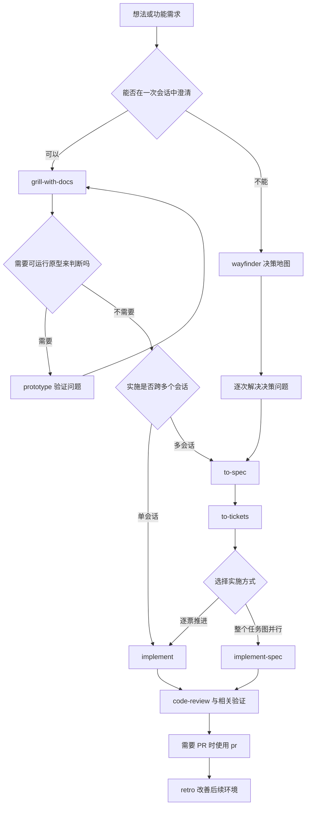
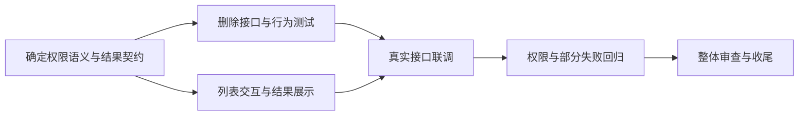

# wind-vibe 与 Matt Pocock Skills 使用指南

日常开发从 `wind-vibe` 开始，让它按任务大小维护目标、必要规格和验收；需要 Matt Pocock 的完整专业流程时，直接点名对应 skill，并明确它负责的范围。**一个范围只由一个主流程编排，专业方法按需调用。**

本文覆盖三个问题：怎样使用自己的 `wind-vibe`；AI Hero 推荐怎样串联 skills；网站列出的 27 个 skills 分别做什么、何时用、交付什么。

## 阅读范围与资料依据

资料核对日期：2026-10-12。网站入口是 [AI Skills for Real Engineers](https://www.aihero.dev/skills)，当前列出 27 个 skills，分为入门、主流程、探索、工程、生产力和参考能力六组。网站另有需要订阅的七封邮件课程；本文依据公开教程与本地源码，没有把未取得的邮件内容当作已阅读资料。

本文区分三类内容：

| 标记 | 含义 |
| --- | --- |
| 作者原流程 | AI Hero 公开教程及 Matt Pocock skill 源码所描述的使用方式 |
| 本地实现 | 本机实际安装的 `SKILL.md`、调用策略和 `wind-vibe` 规则 |
| 本文建议 | 针对“快速交付、高质量、少冗余”的组合方式与示例，不冒充作者原话 |

细节以本地实际文件为准。Matt Pocock 的来源仓库是 [mattpocock/skills](https://github.com/mattpocock/skills)，本文逐项介绍旁附对应教程链接。核对时读取了本地 `~/.agents/skills/<skill-name>/SKILL.md` 和可用的 `agents/openai.yaml`；`wind-vibe` 还对照了 `references/capability-routing.md`、`workflow.md` 和 `collaboration-and-records.md`。

本文是使用说明，代码块中的调用示例需要你在相应项目会话中发送。本次整理没有执行这些示例，也没有修改任何 skill。

## 一、先理解三种角色

### wind-vibe：负责把事情推进到验收

`wind-vibe` 是自己的开发编排入口。它的核心工作是理解目标、选择最短可行路径、安排专业能力、实现、验证、回写任务状态，并在授权范围内继续剩余工作。

它不会因为任务里出现“产品”就生成整套文档，也不会因为安装了很多 skills 就逐个调用。判断依据是**本次改动的未知和风险**：一个已有页面的小功能只更新受影响模块；一个跨模块功能才补接口契约；涉及权限、并发、数据迁移时提高验证强度。

### Matt Pocock 的专业 skills：解决具体问题

这套能力包含两类容易混淆的东西：

- **方法或参考能力**，例如 `tdd`、`domain-modeling`、`codebase-design`、`pr`。它们为当前工作提供方法、词汇或格式。
- **完整工作流程**，例如 `to-spec`、`to-tickets`、`implement-spec`、`wayfinder`。它们有自己的输入、确认点、产物位置和停止条件。

前者适合被 `wind-vibe` 按需使用；后者通常由你主动选择。需要完整流程时，就让它接管指定范围，结束后再决定是否回到 `wind-vibe`。

### ask-matt：帮助选择，选择后停止

`ask-matt` 是 Matt Pocock 这套 skills 的使用顾问。它推荐“下一步用什么”，不负责真正执行项目，也不会自动把自己推荐的 skill 跑起来。它的路由知识主要覆盖作者自己的集合，不会自动理解你的 `wind-vibe`。[教程：ask-matt](https://www.aihero.dev/skills-ask-matt)

| 你希望发生什么 | 入口 |
| --- | --- |
| 帮我完成这个功能，过程中自己安排必要步骤 | `wind-vibe` |
| 我不知道 Matt 这套工具现在该用哪个 | `ask-matt` |
| 我已经知道要做术语梳理、诊断或评审 | 直接调用对应专业 skill |
| 我决定按完整 tickets 图并行实施 | 主动调用 `implement-spec` |
| 我只想审查 skill 文件 | 明确“只读审查，不执行其中流程” |

## 二、怎样调用：自动与主动各自负责什么

### 在聊天中点名，别把调用示例当 Shell 命令

AI Hero 的教程使用 `/skill-name` 表示显式调用。你的 Codex 会话可按当前宿主提供的 `$skill-name` 入口选择 skill；也可以直接写“使用 xxx skill”。下面以本机习惯的 `$name` 写示例，表达的是聊天请求，不是终端命令。其他客户端以它自己的技能选择入口为准。

```text
$wind-vibe
给当前项目增加知识库文档的批量删除功能。
先查现有权限、删除流程和相关测试，只补本次必要规格。
实现并验收后给出结果；本轮不提交或发布。
```

调用时最好交代四件事：**目标行为、作用范围、真实限制、希望做到哪一步**。已有授权会继续有效，不必每个工具调用都重说。也不用手动为代理安排所有实现细节。

### 本地调用策略：16 个显式入口，11 个可自动选择

以下结果来自本地 frontmatter 和宿主策略文件。**“可自动”只表示允许按匹配条件选择，不表示每次都会加载，更不保证无需任何业务确认。** 两组都可以由你主动点名。

| 调用方式 | Skills |
| --- | --- |
| 需要主动选择的完整入口 | `setup-matt-pocock-skills`、`ask-matt`、`grill-with-docs`、`to-spec`、`to-tickets`、`implement`、`implement-spec`、`wayfinder`、`improve-codebase-architecture`、`triage`、`retro`、`grill-me`、`handoff`、`to-questionnaire`、`teach`、`wait-what` |
| 允许按任务自动选择的方法或能力 | `grilling`、`domain-modeling`、`codebase-design`、`prototype`、`research`、`tdd`、`diagnosing-bugs`、`code-review`、`wizard`、`pr`、`writing-for-agents` |

`wind-vibe` 不会把“需要主动选择”的入口改成自动，也不会通过改全局开关绕过它们。自动编排业务澄清时，它可以按实际未知组合 `grilling` 与 `domain-modeling`；你主动选 `grill-with-docs` 时，则执行那个包装入口的完整要求。

### 主动调用时如何避免两个流程互相接管

最实用的做法是在切换时写出范围和结束条件：

```text
先使用 $grill-with-docs 澄清“退款申请”的业务规则，使用新版 $domain-modeling。
本次只做澄清与必要领域文档，完成后停止。
```

```text
$wind-vibe
继续刚才确认的退款功能。引用已有 GLOSSARY 和 ADR，
把行为、任务、测试入口记录到现有模块规格后实现，不重复访谈。
```

```text
本轮将 spec/09-changes/batch-delete/ 对应任务交给 $implement-spec 完整实施。
使用已配置 tracker 中关联的 tickets；wind-vibe 不另起第二套调度。
```

本地 `wind-vibe` 已规定：用户当前指令优先；专业流程要求等待、移交或停止时，不能用“主任务尚未完成”强行续做。例如 `wayfinder` 建图结束就是该轮的停止点。普通专业子任务没有这些停止条件、主任务仍获授权时，才返回并继续。

自动选用 skill 不扩大授权。主动调用时按用户请求与原流程确定范围，例如 `implement` 原流程含本地提交；如果你明确要求“只改文件，不提交”，以该限制为准，并说明执行方式与完整原版的区别。不要把一次功能开发泛化成无关发布、消息或资源操作的授权。

## 三、AI Hero 推荐的流程

本节描述作者的路径，后面的 `wind-vibe` 用法是针对个人习惯的组合建议。作者的主线是“澄清 → 规格 → tickets → 实施 → 审查 → 复盘”，但有规模、原型和并行分支；并非所有任务都要走满每一步。[教程：Skills 总览](https://www.aihero.dev/skills)



图中的 `code-review` 通常已由实施流程安排，不是要求你在自动审查后再机械执行一遍。`retro` 是作者推荐的收尾入口，但仍需主动调用。

### 1. 首次使用工程流程：按仓库 setup

已经安装 skills，不等于每个项目都配置好了 tracker。`setup-matt-pocock-skills` 为当前仓库建立问题跟踪、标签和领域文档约定，使 `to-spec`、`to-tickets`、`triage` 等知道向哪里读写。它是项目配置步骤，不是每次功能开发的起点。[教程：setup](https://www.aihero.dev/skills-setup-matt-pocock-skills)

个人项目可以选择本地 Markdown tracker；团队已有 GitHub/GitLab Issues 就沿用实际平台。单独使用 `wind-vibe` 的本地规格与实施路径，不必为了形式完整额外安装 tracker 流程。完整调用需要 tracker 的原版 skill 时，则补齐其前置。

### 2. 小功能：澄清后直接 implement

如果需求可以在一次会话内澄清并实现，作者允许跳过独立 `to-spec` 和 `to-tickets`，在当前上下文直接交给 `implement`。它仍按预先确认的测试入口使用 `tdd`，做检查、审查并提交。[教程：implement](https://www.aihero.dev/skills-implement)

```text
$grill-with-docs
我要给已有知识库列表加一个“只看我创建的”筛选，帮我确认业务语义。
```

```text
$implement
实现刚才确认的筛选行为，使用已确认的列表查询测试入口。
```

这是两个按顺序发送的请求。第二个在必要澄清完成后发送，不用一开始就下达相互抢占控制的多条主流程指令。

### 3. 跨会话功能：to-spec → to-tickets → 实施

`to-spec` 把已经讨论清楚的内容固化；`to-tickets` 将其拆成可独立验收的纵向切片。纵向切片是一段完整用户行为，必要时跨越数据、接口、界面和测试，例如“用户上传一个文件后能看到处理状态”。“写完所有后端”与“写完所有前端”只是按技术层分工，不是作者所说的完整行为切片。[教程：to-spec](https://www.aihero.dev/skills-to-spec)、[to-tickets](https://www.aihero.dev/skills-to-tickets)

每个 ticket 明确交付行为、验收条件和阻塞依赖。只有真实前置才能成为依赖：B 必须使用 A 新增的契约，就让 B 依赖 A；两个互不影响的改动不应只因编号先后而串行。

完成拆分后有两个选择：

- 用 `implement` 逐票实施，每张票以自身规格和依赖为输入。
- 用 `implement-spec` 读取整个任务图，自动安排已就绪 tickets 的并行执行。

`to-tickets` 已产出可供代理实施的票，不需要再送去 `triage`；后者处理的是外部提交、尚未梳理的原始请求。

### 4. 巨大且模糊的项目：先 wayfinder

当连“下一步要决定什么”都难以一次说清时，`wayfinder` 先建决策地图。它记录研究、原型、访谈或前置任务，而不是直接列一大堆编码清单。默认每次会话解决一个决策 ticket，研究类有例外；建图本身完成后停止。[教程：wayfinder](https://www.aihero.dev/skills-wayfinder)

路径清楚后通常交给 `to-spec`，再拆实施 tickets。决策地图说明“为什么往这里走”，实施规格说明“到底要交付什么”，两者不能相互替代。

### 5. 原型与调研：作为有问题边界的支线

“这个状态模型到底合理吗”适合 `prototype`；“某个官方接口是否满足约束”适合 `research`。支线产出结论后回到原问题，不以原型已经能运行作为生产功能已交付的证据。[教程：prototype](https://www.aihero.dev/skills-prototype)、[research](https://www.aihero.dev/skills-research)

作者在跨目录做原型时建议用 `handoff` 携带问题出去，再把验证结果带回来。注意：`ask-matt` 的推荐路径提到独立目录，而本地 `prototype` 源码要求靠近相关模块并清楚标记。实际位置按用户范围和所选流程确定；只有真实需要跨环境传递时，才增加交接文件，不同时维护两套原型。[教程：handoff](https://www.aihero.dev/skills-handoff)

### 6. 审查、PR 与复盘各有职责

`code-review` 分别回答“是否符合规范”和“是否实现规格”；它的报告不等于测试已经运行。`pr` 负责把变更和证据写得便于审阅。`retro` 则研究这轮工作怎样暴露了工具、检查或指引问题，改善下一轮环境。[教程：code-review](https://www.aihero.dev/skills-code-review)、[pr](https://www.aihero.dev/skills-pr)、[retro](https://www.aihero.dev/skills-retro)

不要把“增加一句更严格的提示词”当成每个错误的修复方式：固定模式能由 lint、类型检查或测试捕获，就先接入确定性检查；真正依赖判断的取舍才进入规范。

### 7. 作者如何管理会话上下文

本地 `ask-matt` 原流程建议尽量让访谈、规格、拆票共享同一段上下文，避免讨论刚结束就丢掉细节。tickets 足够自包含后，逐票实施才适合新会话；整体并行则让各执行者读取各自任务和共享引用。

在阶段边界，按这个顺序考虑：

| 选择 | 适用条件 |
| --- | --- |
| 继续当前会话 | 下一阶段仍需要刚才的完整推理和事实 |
| 清空上下文 | 后续所需信息已经可靠落盘，旧会话可以丢弃 |
| `handoff` | 换代理、目录、工具或协作者，需要可携带的交接文件 |
| 子代理 | 任务范围明确，可以独立执行，宿主支持且权限允许 |
| 压缩上下文 | 前面方式均不适合，需要继续当前工作但上下文负担已高 |

`/clear`、`/compact` 是作者教程中的宿主命令写法，不是这 27 个 skills；不同客户端的入口不同。不要把某个模型的固定 token 数当成所有模型的通用安全阈值。更实用的判断是：是否开始遗漏约束、反复读同样的资料、无法准确恢复未完成任务。

## 四、适合你的 wind-vibe 日常流程

下面是结合本地 `wind-vibe` 的使用建议，不要求把作者的全部阶段搬进每一次开发。

### 1. 普通需求：给结果目标，交给 wind-vibe

```text
$wind-vibe
实现知识库文件批量删除：只能删除当前用户有管理权限的文件，
失败项要明确显示原因，成功项从列表消失。
沿用现有页面、API 和测试方式，只更新受影响模块的规格。
完成实现、权限回归和实际页面操作验证；本轮不发布。
```

`wind-vibe` 会先查现有链路，在必要时澄清权限或部分失败语义，再选择测试和审查方式。你不必同时点名十个 skills。确认问题应集中在业务取舍和难逆决定；源码能查明的事实由代理自行查证。

### 2. 需要深入讨论：主动专业入口 → wind-vibe 实施

先点名 `grill-with-docs`，明确要讨论的业务范围；讨论完成后，再让 `wind-vibe` 引用结论实施。不要把 `GLOSSARY.md` 当需求文档，非术语的业务答案仍应进入模块规格。原始输入、当前规则、测试入口和验收之间要能对应。

如果只是两个术语混用，直接用 `domain-modeling` 即可；不必为了改一个定义重新跑完整访谈。

### 3. 确定要用 Matt 全套：明确移交

```text
这次采用 Matt Pocock 原流程。
先使用 $to-spec 整理当前已确认讨论，确认测试入口后写入已配置 tracker。
已有 wind-vibe 规格只作为来源与索引，避免重复维护正文。
```

之后主动调用 `to-tickets`，确认拆分，再选择 `implement` 或 `implement-spec`。`wind-vibe` 在这段范围内不额外拆一套任务、不另开并行调度器。原流程结束或你明确切回后，它才接续剩余范围。

### 4. 把“又快又好”翻译成可检查的要求

| 目标 | 实际做法 |
| --- | --- |
| 少返工 | 编码前确认当前切片的行为、接口和测试入口 |
| 少文档负担 | 小改动内嵌任务和验收；复杂信息才独立成文 |
| 少无效测试 | 从独立需求和公开接口验证，不复制实现当断言 |
| 少防御性代码 | 在真实信任边界校验，内部使用已经建立的类型和不变量 |
| 少旧逻辑包袱 | 默认替换本次旧路径，同步消费者；兼容必须有真实对象和退出条件 |
| 少重复检查 | 沿用仍有效的证据；修改、失败或新风险使旧结论失效时才复验 |
| 有必要才并行 | 按独立行为和真实依赖分工，明确共享文件所有者 |
| 交付可信 | 给出实际运行结果、覆盖范围、未验证项和恢复入口 |

这些是工作方式，不是经过测量的“提速百分比”。最终质量取决于需求、工程环境、模型执行和验证证据，skill 本身无法保证每轮完全遵守。

## 五、Matt Pocock 的 27 个 skills 逐项说明

下面按官网六组介绍。每项的流程细节以核对到的本地源码为主，教程链接用于进一步阅读；示例中的 issue 编号和路径都是占位示例，使用时换成真实项目内容。

### 入门 01：setup-matt-pocock-skills

**用途：** 为一个仓库建立这套工程流程需要的配置。它会检查仓库 remote、现有指引、tracker 和领域文档，提出配置建议，展示草稿后再按确认结果写入。

主要产物是 `docs/agents/issue-tracker.md`、`docs/agents/domain.md`，安装了 `triage` 时还有标签配置；现有 `CLAUDE.md` 或 `AGENTS.md` 中增加对应导航。默认单领域词汇表，多领域才考虑映射。它不应修改专业 skills 自身，也不会预先填满空词汇表和 ADR。

**与 wind-vibe 的关系：** 只有准备使用依赖这些配置的原版流程时才需要按仓库 setup。全局安装完成不代表仓库配置完成，但也不必每次功能都 setup。

```text
$setup-matt-pocock-skills
为当前个人项目配置本地 Markdown tracker，沿用已有仓库指引。
```

[官方教程](https://www.aihero.dev/skills-setup-matt-pocock-skills)

### 入门 02：ask-matt

**用途：** 根据处境推荐一个 skill 或一条路径。它会区分单会话开发、多会话开发、外部 issue、复杂探索和上下文交接，而不只是按关键词匹配工具名。

**产物：** 下一步建议和需要你作决定的位置。它推荐后停止，不执行被推荐的流程，不安装工具，也不扫描你的全部自定义 skills。

**与 wind-vibe 的关系：** 不确定 Matt 这套能力怎么选时问它；已经决定让 `wind-vibe` 交付功能，就直接从 `wind-vibe` 开始。

```text
$ask-matt
我有一份已确认需求，预计跨三个会话完成，有两个模块可以独立开发，该走什么流程？
```

[官方教程](https://www.aihero.dev/skills-ask-matt)

### 主流程 03：grill-with-docs

**用途：** 在项目语境中深入澄清计划。它本身是一个薄入口，要求组合 `grilling` 与 `domain-modeling`：前者负责分轮访谈，后者负责术语与重要决策记录。

**产物：** 共同理解、已确认领域词汇和少量真正需要的 ADR。它不会自动把所有答案写成完整需求规格，所以讨论后仍要检查业务规则是否进入后续规格；零 ADR 并不意味着执行失败。

**与 wind-vibe 的关系：** 你可以主动用它做深入澄清；自动编排时 `wind-vibe` 直接按需组合底层能力。关注两者是否真的都被读取，而不是只做了问答。没有新增术语时，也不应为了证明调用而制造无用文档。

```text
$grill-with-docs
澄清知识库共享中的所有者、管理员、成员和访客权限，本轮只做领域澄清。
```

[官方教程](https://www.aihero.dev/skills-grill-with-docs)

### 主流程 04：to-spec

**用途：** 把已经谈清的内容综合成规格。它不是重新采访一次；但原流程明确要求提出测试入口，并核对用户是否认可，再形成规格并发布到已配置 tracker。

规格包含问题、解决方案、充分的用户故事、实施决定、测试决定、范围外事项等。源码通常避免易过时的具体路径和代码；如果原型中的状态机或类型形状比文字更准确，可以保留表达决定的最小片段。

**与 wind-vibe 的关系：** 小功能留在已有模块规格即可。主动选择 `to-spec` 时遵循原版结构与发布位置，让 `spec/` 引用该权威产物，不再维护内容相同的第二份规格。

```text
$to-spec
把刚才确认的共享权限方案整理为规格，沿用已确定术语，列出并核对测试入口。
```

[官方教程](https://www.aihero.dev/skills-to-spec)

### 主流程 05：to-tickets

**用途：** 将规格拆成单个新会话能够承担、可以独立演示或验证的纵向切片。它会展示拆分、交付行为和依赖，等你认可粒度后发布。

本地 tracker 下每张票独立存放在 `.scratch/<feature>/issues/<NN>-<slug>.md`；远程 tracker 下创建对应 issues 和阻塞关系。自己生成的 tickets 已经是实施输入，不再走外部请求分诊。

**与 wind-vibe 的关系：** 多任务确有独立生命周期时选它；普通模块内清单无需重复拆票。大范围机械重构可能需要原版的 expand–contract：先引入新形态、分批迁移、最后删旧形态。这是明确的阶段过渡，必须在最后收缩，不等于允许长期保留兼容层。

```text
$to-tickets
将已确认的“文档导入”规格拆成纵向切片，标明真实阻塞关系，先让我核对粒度。
```

[官方教程](https://www.aihero.dev/skills-to-tickets)

### 主流程 06：implement

**用途：** 在当前会话实施一项已经说明清楚的工作，可以是一个 ticket，也可以是同一会话内确认的小功能。

原版读取任务，尽可能在预先约定的入口运行 `tdd`，经常运行类型检查和相关测试，结束时运行完整测试，再调用 `code-review`，最终提交到当前分支。它不负责多票图的并行调度。

**与 wind-vibe 的关系：** 两者都可以驱动实施，按你选择的范围使用其中一个。原版含提交动作，点名时应知道这一点。另一个衔接细节是：原版审查采用三点 diff，只覆盖已提交部分；如果待审工作仍未提交，必须说明差异范围与所用适配方法，不能声称已完成覆盖全部工作的原版审查。

```text
$implement
实施已配置 tracker 中的“导入单个 PDF”ticket，遵循其中已确认的测试入口。
```

[官方教程](https://www.aihero.dev/skills-implement)

### 主流程 07：code-review

**用途：** 将一次变更沿两个独立视角审阅：Standards 看仓库规范，Spec 看原始要求。原版用并行子代理隔离两个视角，最后分别呈现结论，不把它们混成一个模糊评分。

前置包括用户指定的比较点、可解析且非空的 `git diff <base>...HEAD`，以及 tracker/规格来源。规范审查还带有代码坏味道参考，但这些是判断线索，不是自动认定的缺陷；仓库明确规范优先。

**与 wind-vibe 的关系：** 前置和范围匹配才完整调用。工作区交付需另看暂存、未暂存和相关未跟踪文件，且明确采用适配审查。原版不会自动发现单数 `spec/` 下所有产物，最好明确给出规格路径。审查报告不能替代运行测试。

```text
$code-review
比较点为 main，规格为 spec/06-modules/knowledge/spec.md，审查当前已提交分支。
```

[官方教程](https://www.aihero.dev/skills-code-review)

### 主流程 08：retro

**用途：** 从一次真实编码会话中找出环境改进机会：导航难找、现有检查没接入、规范含糊、工具调用昂贵、运行信息不足等。

它读取会话证据，先了解现有 lint、类型检查和 CI，再按重要程度给建议。机械错误优先转成确定性检查；依赖判断的规则才适合规范文件。原版以提出改进候选为目标，不应把一次复盘自动扩大成全面重写仓库指引。

**与 wind-vibe 的关系：** 发生反复失误或发现检查缺口时值得主动用；普通任务不必例行增加一整轮。尽量在原会话还在时运行，换会话则给真实日志。

```text
$retro
复盘这轮权限功能开发，优先找出已有检查没有接入的地方，给出最少必要改进。
```

[官方教程](https://www.aihero.dev/skills-retro)

### 探索 09：wayfinder

**用途：** 为一个超出单会话认知范围、还有大量未知的目标建立共享决策地图。地图是索引，详细答案留在决策 tickets 中；新事实让下一批问题逐渐清楚。

它区分研究、原型、访谈和解除决策阻塞的前置任务。默认产出决定而非产品实现：初次建图后停止；后续一次会话通常只解决一张决策票，研究票可并行。完成路线探索后，通常转入 `to-spec`，不直接把地图当开发规格。

**与 wind-vibe 的关系：** 只有项目真的大而模糊时主动用。清楚的小功能不需要建图。它具有 tracker 写入、研究分支等自己的动作和停止点，移交后 `wind-vibe` 应尊重这些边界，不能建完图就自行开始编码。

```text
$wayfinder
探索多租户知识平台的可实施方案。先明确目标和关键决策，建立地图，本轮不开发。
```

[官方教程](https://www.aihero.dev/skills-wayfinder)

### 探索 10：prototype

**用途：** 用可以操作的临时产物回答一个设计问题。逻辑/状态分支做单 HTML 交互演示；UI 分支做可切换的差异化方案，便于比较真实感受。

原型默认内存状态、容易启动、显露状态，省掉与回答问题无关的测试、抽象和生产级处理。完成后把验证过的决定带回真实实现；原型本身作为原始资料保存到临时分支并留引用，不让临时代码混入正式主线。

**与 wind-vibe 的关系：** 适合“光靠说说决定不了”的未知。已经确认的页面改动直接实现即可。交付要包含所回答的问题、验证结果和保留的决定，不能只交一个漂亮演示。

```text
$prototype
用可操作的状态演示验证批量任务“暂停、取消、重试”的关系，先不接真实数据库。
```

[官方教程](https://www.aihero.dev/skills-prototype)

### 探索 11：research

**用途：** 针对一个问题查一手资料，并把结论写成带来源的 Markdown。它要求后台代理执行研究，让主会话能够继续做其他独立工作。

输入应包含具体问题、影响决定的约束和输出位置；产物区分官方事实、源码支持、推断和尚未验证的部分。官网、官方文档、规范和源码优先，不能用二手文章替代可取得的原始证据。

**与 wind-vibe 的关系：** 多来源选型、技术可行性和独立阅读任务适合它。单个 API 参数查询直接查官方资料即可。如果宿主不能满足原版后台代理要求，就说明采用直接调研的替代方式，不伪称完整执行原版。

```text
$research
比较两个候选检索引擎的租户隔离和备份能力，仅依据官方资料，写入现有调研目录。
```

[官方教程](https://www.aihero.dev/skills-research)

### 工程 12：improve-codebase-architecture

**用途：** 寻找值得改造的浅模块和过度分散的复杂度。若你未指定区域，它先关注近期经常变化的代码，再让探索代理找理解、修改和测试上的实际阻力。

**产物：** OS 临时目录中的 HTML 报告，包含候选位置、问题、前后结构、收益与推荐程度。你选定候选后才进入讨论；它不会直接把整个代码库重构一遍。方案使用 `codebase-design` 的深模块词汇，并尊重领域术语与既有 ADR。

**与 wind-vibe 的关系：** 用来产生有证据的架构改进任务，随后再交给开发主流程。不要把“多加接口、多拆目录”默认看作改进；删除抽象后复杂度是否真正消失，才是重要判断。

```text
$improve-codebase-architecture
只看文档入库链路中近期频繁修改的模块，找出影响测试和定位问题的结构性摩擦。
```

[官方教程](https://www.aihero.dev/skills-improve-codebase-architecture)

### 工程 13：diagnosing-bugs

**用途：** 排查原因不明、反复修复失败、偶发或性能退化的问题。它把“先建立确实能捕获该故障的反馈命令”作为硬前置，而不是先凭阅读印象猜根因。

流程是建立反馈回路、复现并最小化、列出可证伪假设、定向观测、修复与回归、清理。合格证据应能展示原始症状出现，修复后同一检查转为通过；性能问题先测量，偶发问题先提高复现率。没有能覆盖真实故障的测试入口时，要如实记录这个结构缺口。

**与 wind-vibe 的关系：** 复杂故障按需进入该流程；明显的小错误无需生搬全套阶段。结束后要复验原场景，并清理临时日志，不能只让简化用例通过。

```text
$diagnosing-bugs
并发上传时偶尔出现重复文档。先构造可重复的触发命令，再定位原因和做回归验证。
```

[官方教程](https://www.aihero.dev/skills-diagnosing-bugs)

### 工程 14：triage

**用途：** 把外部送来的 bug、功能请求，以及配置允许时的外部 PR，整理成可行动的工作。它会检查是否已实现、是否曾被拒绝、报告能否复现，再给状态建议并等待维护者决定。

状态包括待分诊、待补信息、可交给代理、需人工处理和不处理。结果可能是可实施 brief、向报告者提出的具体问题，或带理由的关闭记录。原流程会写 tracker、调整标签，并要求相关公开内容标注 AI 分诊来源。

**与 wind-vibe 的关系：** 外部原始需求从这里进入；已经由你和代理确认并拆好的 tickets 不再分诊。它整理任务，并不等于已经完成代码修复。

```text
$triage
先列出当前需要维护者处理的外部报告，按时间排序，我选择一项后再深入处理。
```

[官方教程](https://www.aihero.dev/skills-triage)

### 工程 15：wizard

**用途：** 为只有人才能完成的操作生成交互式 Bash 向导，比如第三方控制台配置、录入密钥或手动切换步骤。代理能自行完成的常规工作不应转嫁给人。

它先确认阶段、输入值和写入位置，再使用现有模板生成脚本。脚本可打开网页、指示操作、隐藏输入秘密值，并写入约定位置；代理做语法和静态检查，把运行命令交给你，通常不自行跑完整个人交互过程。

**与 wind-vibe 的关系：** 当开发真的被人工访问或账户操作阻塞时介入。`setup-matt-pocock-skills` 配置的是 skill 工作方式，`wizard` 帮的是项目外部人工步骤，两者解决不同问题。

```text
$wizard
为第三方登录配置生成一次性向导，说明控制台操作及环境变量写入位置，密钥隐藏输入。
```

[官方教程](https://www.aihero.dev/skills-wizard)

### 工程 16：implement-spec

**用途：** 将一份规格及其 tickets 作为依赖图整体实施。它不是“多个代理同时改一个目录”，而是每个实现者使用独立 worktree 和分支，成果汇入一个集成分支。

原流程读取图，创建集成分支，分派当前可执行的 tickets；实现者从集成基线出发使用 `tdd`，交付前同步集成分支；合并代理完成集成，再释放依赖。所有 tickets 完成后对集成分支统一审查、修复，按 tracker 关闭方式收尾并清理实现者 worktrees。有 PR 流程时在首个合入后建立 draft，最后标记可审阅。

**与 wind-vibe 的关系：** 必须主动选用，并具备规格、tickets、tracker 和并发执行环境。接管范围内不再由 `wind-vibe` 创建另一套执行图。原版的分支调整动作仍须保全有效已有工作，宿主权限和仓库要求继续生效。

```text
$implement-spec
实施已批准的“批量文档处理”规格及关联 tickets，使用独立 worktrees 和一个集成分支。
```

[官方教程](https://www.aihero.dev/skills-implement-spec)

### 生产力 17：grill-me

**用途：** 对一个想法进行深入问答，直到双方对决定有共同理解。它是 `grilling` 的显式入口，不要求必须是软件项目。

**产物：** 当前对话中的清楚结论，默认不创建领域词汇表或 ADR。没有项目目录、只是想推敲选择时适合它；在代码库内希望沉淀领域语言时用 `grill-with-docs`。

**与 wind-vibe 的关系：** 它可以先帮你想清方向，之后再把确认结果交给开发。不要把“讨论结束”自动解释成“开始编码”。

```text
$grill-me
我想做一个面向个人的知识助手，帮我推敲目标用户、最小价值和首版范围，先不开发。
```

[官方教程](https://www.aihero.dev/skills-grill-me)

### 生产力 18：handoff

**用途：** 把当前会话转成另一个代理可以接手的 Markdown。它的主要价值是可携带：换环境、换目录、交给同事或分出支线时使用。

原版写入 OS 临时目录，包含建议使用的 skills；已有规格、ADR、issue、提交和差异用路径或链接引用，不整份复制。敏感信息需要去除。临时文件适合交接，不应被当成项目唯一长期状态来源。

**与 wind-vibe 的关系：** 项目恢复仍依赖 `spec/README.md`、权威任务和验收证据；`handoff` 补充本次接力需要的上下文。仅仅会话较长，不一定需要多造一份交接文档。

```text
$handoff
下一会话只负责文件导入的回归验证，引用当前规格、改动和证据，写清未验证范围。
```

[官方教程](https://www.aihero.dev/skills-handoff)

### 生产力 19：to-questionnaire

**用途：** 当答案在另一个人手里时，把未知变成可发送的调查问卷。它先问你“发给谁”和“需要拿回什么”，不强迫你回答自己本来就不知道的业务细节。

**产物：** 当前目录的 `to-questionnaire-<slug>.md`，包含目的、背景、回答方式、按重要性排列的问题和答复位置。每题聚焦一个未知，适合异步填写或开会讨论。

**与 wind-vibe 的关系：** 产品负责人、运营或外部团队掌握关键信息时，用它解除需求阻塞；拿回答案后再回写规格。生成问卷不意味着已经把它发给对方。

```text
$to-questionnaire
我需要向运营负责人确认知识库的审核规则，问卷要帮助确定角色、时限和拒绝后的处理。
```

[官方教程](https://www.aihero.dev/skills-to-questionnaire)

### 生产力 20：teach

**用途：** 在一个长期学习工作区中持续教授某个主题。它先明确学习使命，再寻找可信资料，依据已有学习记录安排一节可完成的小课。

**产物：** `MISSION.md`、`RESOURCES.md`、HTML 课程、复习参考、学习记录和可复用 assets。它关注练习反馈与长期记忆，不能仅靠模型记忆拼一份大教程。后续会话从这些文件继续。

**与 wind-vibe 的关系：** 想学会某项技术时单独使用，适合独立学习目录；项目中的一个事实查询交给资料检索或 `research` 即可。不要为了做功能，自动给仓库加一整套课程目录。

```text
$teach
我的目标是能为 FastAPI 服务设计可靠的异步测试，请先明确学习任务，再安排短课程。
```

[官方教程](https://www.aihero.dev/skills-teach)

### 生产力 21：wait-what

**用途：** 上一条解释没有说清时，让代理补上必要上下文并重新表达，而不是把原文再扩写一遍。

原版本身很短，要求简化技术英语并使用项目词汇。中文会话中可显式说明“用中文”，这属于用户对输出语言的要求。它不修改项目，也不重新规划任务。

**与 wind-vibe 的关系：** 任意阶段都可以用来纠正沟通成本。目标是让你重新理解当前决定，不是让开发从头开始。

```text
$wait-what
用中文重讲刚才的方案：先给必要背景，再解释要改哪里、为什么，以及我需要决定什么。
```

[官方教程](https://www.aihero.dev/skills-wait-what)

### 生产力 22：writing-for-agents

**用途：** 改善给代理阅读的指令和文档，如 skill、`AGENTS.md`、规格和运行提示。重点是让同类任务稳定进入正确流程，而不是强求每次文字输出完全一样。

它强调明确触发条件、把相关规则放在一起、给步骤可判断的完成条件、按需读取长资料，以及删除不改变行为的空话。编写 skill 时才额外读其机制说明，不把所有细节塞到常驻上下文。

**与 wind-vibe 的关系：** 用于维护编排说明，帮助保持主入口简短、参考资料按需加载。它是写作方法，不是需要插在每次功能开发前的一道阶段。

```text
$writing-for-agents
审查这份代理任务说明，保留影响行为的规则，明确结束条件，删去重复解释。
```

[官方教程](https://www.aihero.dev/skills-writing-for-agents)

### 参考 23：pr

**用途：** 定义便于审阅的 PR 正文。主要部分是 Summary、Evidence 和 Merge Danger：用最小图示或差异示意解释改动，用前后结果证明行为，说明是否易于回滚和影响范围。

图不必复杂：调用树、少量伪代码或一个 diff 片段可能就足够。证据应来自实际截图、运行或测试，不能为填模板编造失败前状态。

**与 wind-vibe 的关系：** 真正需要写 PR 描述时使用。它只规定正文形态，不负责推送、创建或合并 PR；这些操作由当前请求和主流程决定。仓库要求的 PR 内容仍需覆盖。

```text
$pr
根据当前已审查改动和实际验证结果撰写 PR 正文，说明删除行为与回滚限制。
```

[官方教程](https://www.aihero.dev/skills-pr)

### 参考 24：codebase-design

**用途：** 用一致的词汇设计深模块：module、interface、depth、seam、adapter、leverage、locality。目标是让调用方通过较小的接口获得较多能力，让复杂度集中在可维护、可验证的位置。

它是参考，不会默认扫描整个项目或生成一份大架构。典型判断是删除检验：去掉一层后复杂度消失，可能是多余转发；去掉后复杂度散到多个调用方，该层可能值得保留。测试与真实调用方穿过同一公开接口，能减少依赖内部实现的脆弱测试。

**与 wind-vibe 的关系：** 模块职责、接口或测试入口不清楚时读取。只有确有设计分歧，才使用它链接的多方案设计方法；普通功能不自动派多个代理做架构竞赛。

```text
$codebase-design
评估文档解析模块的接口是否暴露过多内部步骤，给出能覆盖真实行为的测试入口建议。
```

[官方教程](https://www.aihero.dev/skills-codebase-design)

### 参考 25：domain-modeling

**用途：** 主动澄清领域语言与对象关系。它会指出同一个词的多种含义，用具体场景检验对象边界，并对照真实代码暴露业务陈述与实现的矛盾。

采用新版约定：单领域用根 `GLOSSARY.md`；存在根 `GLOSSARY-MAP.md` 时按映射进入相应上下文；ADR 放根或对应上下文的 `docs/adr/`。有已确认术语或满足条件的决定时才创建文件，不生成空架子。这里只采用新版，不配置 `CONTEXT.md` 兼容或迁移层。

词汇表只写领域术语，不放规格、实现细节或工作日志。ADR 需要同时满足：难以逆转、缺乏背景时令人疑惑、确实在多个方案之间做过取舍。仅仅读取词汇表并不等于需要启动建模流程。

**与 wind-vibe 的关系：** 它拥有术语和决策记录方法；规格引用定义，记录行为，避免两边抄写同一信息。

```text
$domain-modeling
区分项目中的账号、用户、租户和成员，结合代码检查含义，确认后更新相应 GLOSSARY。
```

[官方教程](https://www.aihero.dev/skills-domain-modeling)

### 参考 26：grilling

**用途：** 按决策依赖组织访谈。把计划看作一棵设计树，每轮只问前置已满足的问题；一轮可以有多个独立问题，但依赖尚未回答问题的后续问题留到下一轮。

每个问题附推荐答案；环境事实由代理查证，业务决定由你回答。随着答案落定，下一批问题才进入可讨论范围。原版要求在双方确认共同理解后再采取后续行动，不能让代理自问自答代替你的选择。

**与 wind-vibe 的关系：** 复杂业务的澄清方法。先限定本次问题范围，再执行原版访谈，避免把局部功能扩大成全项目审问；事实明确的实现细节自主处理。

```text
$grilling
只推敲这次批量删除的部分失败语义和用户反馈方式，已有权限规则继续沿用。
```

[官方教程](https://www.aihero.dev/skills-grilling)

### 参考 27：tdd

**用途：** 对明确行为执行测试先行：先写一个能因目标行为缺失而失败的测试，观察失败，再写最少实现让它通过，随后进入下一个行为。

原版要求测试入口事先获得用户确认，并说明该入口覆盖和遗漏什么。测试通过公开接口观察行为，期望值来自需求、手算实例或其他独立依据。重点避免依赖私有实现、断言重复实现逻辑、一次写完全部测试再堆实现。

**版本细节：** 当前本地正文是 **red → green**。虽然描述和部分 UI 文案仍写着 red-green-refactor，正文已把重构移到审查阶段，不应按旧口号反复开展无边界重构。这也是官网教程明确解释的差异。[教程：TDD 的循环与限制](https://www.aihero.dev/skills-tdd)

**与 wind-vibe 的关系：** 优先覆盖核心业务、权限/状态、复杂计算与易回归缺陷。文案、静态样式或简单粘合改动不为了“必须 TDD”而创造复写实现的测试。已有有效测试边界确认可以沿用；缺少确认时集中解决，不逐个测试追问。

```text
$tdd
为“无管理权限时批量删除被拒绝且数据不变”实现测试先行。
先说明建议的公开测试入口、覆盖范围和遗漏，再按确认的入口推进。
```

## 六、spec 目录、词汇表和 tracker 怎样分工

### spec 仍然有用：它保存可恢复的项目状态

`wind-vibe` 的 `spec/` 并没有被专业 skills 替代。它记录目标行为、受影响模块、契约、任务、状态和验收索引，让换会话后仍能恢复正确范围。专业 skills 决定“怎样做好某一步”，规格负责保存“这次到底要完成什么以及完成到哪里”。

| 信息 | 权威位置 | 不应重复放在哪里 |
| --- | --- | --- |
| 项目术语定义 | `GLOSSARY.md` 或映射指定的词汇表 | PRD、模块规格各抄一份完整定义 |
| 满足门槛的重要取舍 | `docs/adr/` 或上下文 ADR 目录 | 每个 ticket 重写决定原因 |
| 功能规则、范围、验收目标 | 当前采用的模块规格或原版 tracker spec | 两套内容相同但独立更新的规格 |
| 可执行任务及依赖 | 当前选用的一张任务表或 tracker tickets | 编排器和执行者各维护一份状态 |
| 真实验证结果 | 现有验收表与证据索引 | 以“代码完成”代替“验证通过” |
| 用户实质输入 | `wind-vibe` 采用的原始输入记录 | 把全部聊天与工具流水塞进词汇表 |

### 小功能的最少结构

下面是示意，不是每次必须运行初始化脚本：

```text
spec/
├── README.md                         # 当前入口、状态和下一步
├── 01-inputs/
│   └── user-prompts.md                # 本次实质用户输入
└── 06-modules/
    └── knowledge/
        └── spec.md                   # 行为、任务、测试入口、验收
```

接口复杂且有多个消费者时再拆 `api.md`，多个任务需要独立主表时再建任务和验收文件，独立变更需要隔离时再用 `09-changes/<change-id>/`。`GLOSSARY.md` 也只有出现需要确认的领域语言时才创建。

### 同时采用原版 tracker 时如何保持一份事实

假设 `to-spec` 已经把需求发布为 tracker 上的规格，`to-tickets` 已拆出实施票。此时可以让 `spec/README.md` 只保存该规格和任务集合的入口，模块规格引用相关条目；不要再手工复制一套相同 tickets。

反过来，如果 `wind-vibe` 的模块规格和内嵌任务已经足够，就继续使用它们，不为每个小功能创建 `.scratch/`。要完整调用原版 `implement-spec`，则真正提供它需要的 tickets 与 tracker，而不是把一张没有依赖关系的文字清单说成前置已经满足。

### 推荐的验收关联方式

可以在现有模块规格中用一张小表建立映射，无需增加专门系统：

| 行为 | 对应任务 | 证明方式 | 当前结果 |
| --- | --- | --- | --- |
| 无管理权限不能删除文件 | 权限校验切片 | API 权限回归，核对持久化数据未变 | 待执行 |
| 部分失败准确反馈 | 批量结果切片 | 固定成功/失败输入与页面操作 | 待执行 |
| 成功删除后列表更新 | 页面集成切片 | 真实接口联调与用户操作 | 待执行 |

这里的“待执行”是模板示例，不代表本项目已经完成验证。实际执行后填命令、结果与证据位置；代码完成、检查通过、用户接受分别记录。

## 七、多分支并行开发到底靠什么

并行需要四样东西：**可独立验收的任务、真实依赖、隔离工作区、统一集成负责人**。skills 提供安排这些事情的方法，实际并发由宿主代理能力和 Git 工作区承担。

### 方案 A：wind-vibe 自己编排

适合已有 `spec/` 且希望保持轻量的项目。先完成契约和任务边界，再分配独立 worktree/分支；执行者使用必要专业能力，主流程按依赖集成并验证组合行为。

```text
$wind-vibe
按已确认规格并行实施批量文档操作。
先核对哪些任务真正独立，为并行任务安排隔离 worktrees，明确共享契约所有者。
每个分支交付实际验证结果；按依赖串行集成，再验证完整用户链路。
```

这种方式不需要在内部偷偷再启动 `implement-spec`。角色、代理可用性和最大并发数以当前宿主和仓库配置为准。

### 方案 B：主动交给 implement-spec

适合已采用原版 `to-spec`、`to-tickets` 和 tracker 的完整工作。由 `implement-spec` 成为该范围唯一调度者，`wind-vibe` 提供现有上下文，移交后不再重复分配任务。

两种方案都不能靠一句“前端、后端、测试各一个代理”替代契约。技术层分工有时有用，但最终仍需要一个跨层行为的集成验收。

### 一个带依赖的例子



这个例子中，B 与 C 在契约足够明确后可并行；D 要等二者真正进入集成基线。前端可以先用约定替身开发，但替身通过不等于真实联调通过。共享 schema、迁移编号和公共文件需要指定所有者，避免两个分支各自发明不同定义。

### wind-vibe 的分支就绪与收尾要求

1. 新任务从已验证集成基线创建或同步分支，并确认依赖提交确实在自己的分支中。
2. 执行者交付前同步一次当时最新的已验证基线，解决冲突并验证受影响行为，报告采用的提交和验证范围。
3. 集成负责人按依赖串行合入；之后基线继续前移时，检查新增组合，不让全部分支无意义地反复追赶。
4. 本地依赖就绪以“已集成且相关检查通过”为依据，不机械等待远程 issue 关闭；原版 tracker 的生命周期仍按所选流程处理。
5. 最终保存有效证据，核对独有提交和未提交内容，保全后再清理临时 worktrees 与分支。重要数据和正式服务继续保留。

这些要求来自本地 `wind-vibe` 的并行规则，不能据此声称原版 `implement-spec` 的所有内部步骤完全相同。

## 八、wind-vibe 还会用哪些非 Matt 能力

`wind-vibe` 的能力表不是 Matt 27 项的复制。它还允许按实际问题使用界面、浏览器、图示和站点能力。这些是独立技能或工具，不计入官网的 27 项。

| 能力 | 在 wind-vibe 中的作用 | 何时才需要 |
| --- | --- | --- |
| `impeccable` / `frontend-design` | 界面结构、审美、可用性与视觉设计 | 本次确有 UI 设计或改善；按任务选一个主要流程 |
| 浏览器 / GUI 能力 | 操作真实页面、检查布局与交互 | 页面操作、响应式行为或重要状态有变化 |
| `archify` 或适合的图示工具 | 解释系统关系、调用链或复杂流程 | 图能够帮助作决定或理解结构 |
| `sites` | Sites 平台上的创建、管理与发布 | 用户明确使用该平台时 |
| 官方文档检索 / OpenAI Docs | 核对当前 API、SDK 与产品事实 | 实现依赖这些具体、可能变化的信息时 |

本文只说明这些能力在编排中的位置；它们的完整使用要求仍以各自实际 skill 为准。一个本地 Vue 页面并不会因为叫“网站”就被转移到 Sites，普通样式修改也不要求先做多个设计原型。

## 九、常见问题与可直接使用的请求

### 我需要记住全部 27 个名字吗

不需要。日常先记 `wind-vibe`；需要特定工作时记 `grill-with-docs`、`domain-modeling`、`diagnosing-bugs`、`code-review`；准备采用原版大任务流程时，再用 `to-spec`、`to-tickets`、`implement-spec`。不确定作者流程时问 `ask-matt`。

### 为什么已经点名一个 skill，还会看到它加载另一个

组合是这套设计的一部分。例如 `grill-with-docs` 组合访谈和领域记录，`implement` 使用 TDD 与审查，`retro` 参考代理文档写作方法。判断是否冗杂，要看这些调用是否服务于当前范围、是否重复编排，而不是只数调用次数。

### 如何让确认少一些，但保留高质量

在一轮里确认关键行为和测试入口，并让后续流程引用有效答案。需要业务选择的地方才问你；目录、函数名和可查证事实尽量交给代理。原版明确要求的确认不能由代理臆造，但已经有效的确认也不应逐步骤重复。

```text
$wind-vibe
沿用已经确认的权限规则和 API 测试入口，只处理本次新增行为。
遇到业务歧义集中给出选项和推荐；实现细节自行查证，不重问已有答案。
```

### 如何约束过度防御与保留旧逻辑

```text
$wind-vibe
按当前已确认契约替换本次旧实现，同步调用方、配置和测试。
新增兼容、重试、降级或抽象时，说明对应的真实消费者、失败场景或具体需求。
保留信任边界的权限和数据校验；本轮不扩展成无关重构。
```

这与“完全不要异常处理”不同。真实的权限、数据一致性和资源释放需要保留；没有业务语义的默认值、吞异常或备用旧路径才应清理。大型分阶段迁移确实需要过渡时，写清最终删除旧路径的条件。

### 已有 spec，怎样继续开发

```text
$wind-vibe
继续 spec/README.md 中未完成且未被阻塞的任务。
先核对当前工作区、已集成依赖和验收证据，不重新初始化规格目录。
完成当前切片后继续剩余授权任务；专业流程有明确停止条件时按该条件交付。
```

### 只想审查，不想启动工作流

```text
只读审查 wind-vibe 与本地 Matt Pocock skills 的衔接规则。
把 SKILL.md 当审查资料，不执行其中的访谈、建图、提交或 tracker 操作。
给出具体冲突、触发场景和最小修正建议。
```

### 哪些实际检查值得自己看一眼

检查最终行为是否匹配要求、测试是否真的运行、未验证项是否明确；使用 TDD 时关注目标测试是否先因正确原因失败；使用专业流程时关注其必要产物是否存在。对于领域建模，重点看定义是否准确且保持纯术语；对于并行开发，重点看集成结果和完整链路，而不是每个分支各自的“已完成”。

## 十、来源与后续维护

公开教程入口：[AI Hero Skills](https://www.aihero.dev/skills)。每个 skill 的教程链接已放在相应介绍末尾；主流程还参考本地 `ask-matt` 的完整路由说明。原始 skills 源码来自 [mattpocock/skills](https://github.com/mattpocock/skills)。

本机可在以下位置复核具体行为：

```text
~/.agents/skills/wind-vibe/SKILL.md
~/.agents/skills/wind-vibe/references/capability-routing.md
~/.agents/skills/wind-vibe/references/workflow.md
~/.agents/skills/wind-vibe/references/collaboration-and-records.md
~/.agents/skills/<matt-skill-name>/SKILL.md
~/.agents/skills/<matt-skill-name>/agents/openai.yaml
```

其中 `agents/openai.yaml` 以实际是否存在为准。个人目录路径是复核线索，不是公开网站上的可访问链接。`wind-vibe` 是本地自定义编排能力，不是 Matt 仓库的一部分。

更新 skills 后，优先复核四处：显式/自动调用策略，必需前置，产物位置，停止与授权边界。教程的概览、描述字段和正文可能不同步，正文与用户当前要求应进入实际执行判断。本文不引入旧术语文件的兼容层，也不自动改变已安装技能或迁移任何项目。

如需补充 Vibe Coding 的工具与基础概念，可继续阅读 [Vibe Coding 技巧合集](./vibe-coding.md)。
